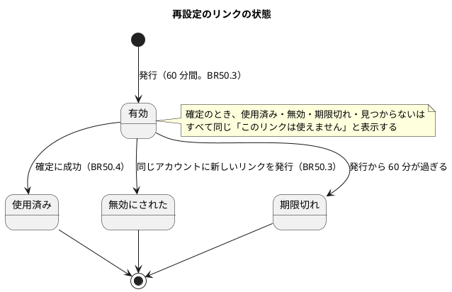
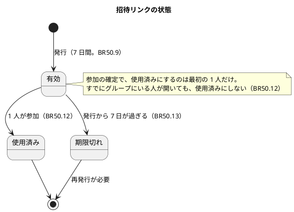
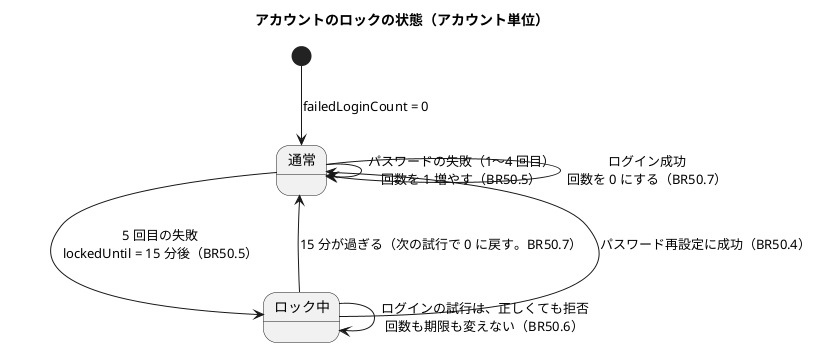
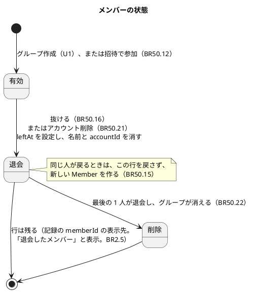
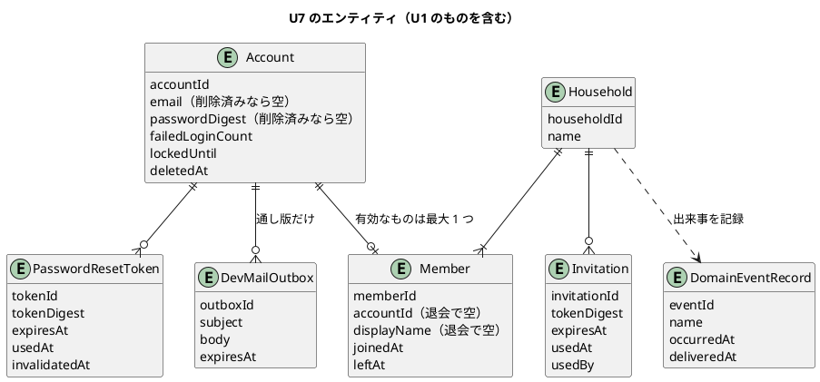
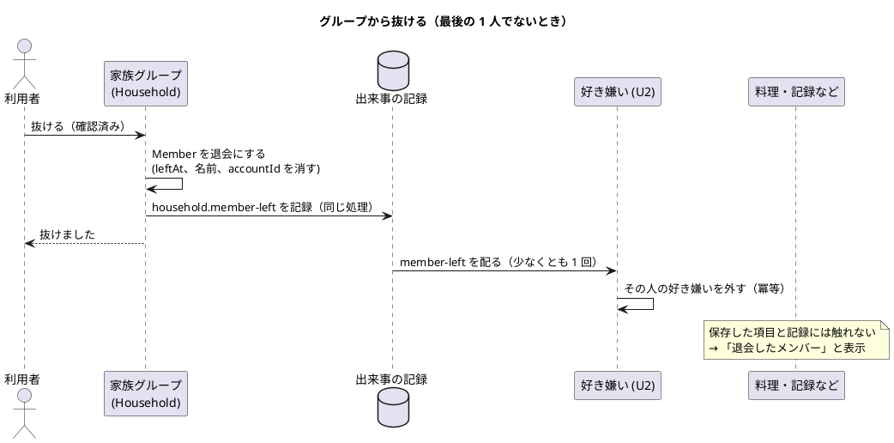
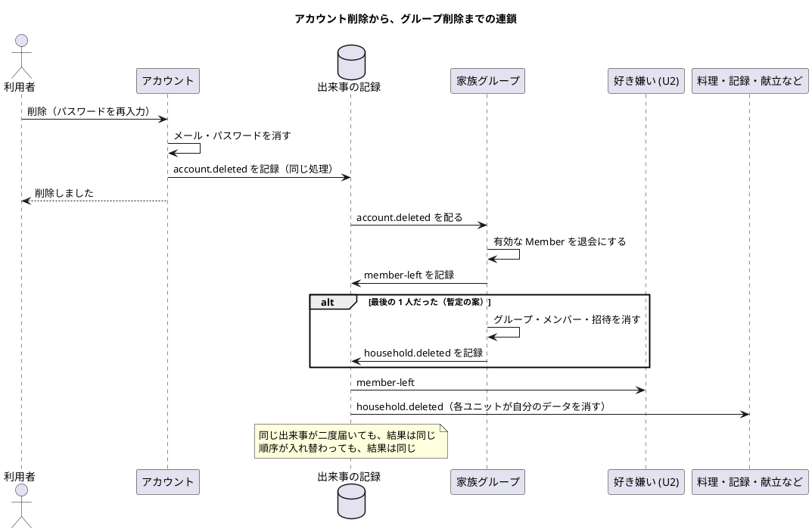

# 機能仕様：U7 グループとアカウントの管理（account-admin）

操作の流れ（ワークフロー）と、状態の移り変わり（状態遷移）の正（source of truth）です。データの形は `entities.md`、判断のルールは `rules.md` が正で、この文書の ER 図とルール一覧は、そこから作った読みやすい版です。技術は決めません。図は PlantUML で書きます。

## 範囲

U7 は、U1 の登録・ログイン・グループ作成の上に、次を足します。

- パスワードの再設定（AC7.1.2）、ログイン失敗の制限（AC7.1.3）
- 招待リンクの発行と参加（AC7.2.1〜AC7.2.3）
- グループから抜ける（AC7.3.1、AC7.3.2）、アカウント削除（AC7.4.1、AC7.4.2）
- 最後の 1 人が抜けたときのグループ削除（AC7.5.1。暫定の案）
- 出来事 account.deleted、household.member-left、household.deleted を出す側

含まないのは、出来事の**受け手**の処理（好き嫌いを外す＝U2、料理・記録・候補・献立・買い物リスト・画像のデータを消す＝各ユニット）です。登録・ログイン・グループ作成は U1 です。

## 用語（日本語 / 英語）

| 日本語 | 英語 | 意味 |
|---|---|---|
| 状態遷移 | State transition | 「有効 → 使用済み」のような、状態の移り変わり |
| ロック | Lockout | 失敗が続いたときに、一定時間ログインを止めること |
| 変換値 | Digest | 元に戻せない形に変えた値。リンクの元の値の代わりに保存する |
| 出来事 | Event | 「メンバーが抜けた」などの知らせ。確定してから配り、届かなければ配り直す |
| 冪等 | Idempotent | 同じ操作や知らせが繰り返されても、結果が同じになること |
| 窓口 | Port | 外部のサービス（メール送信）を、あとから差し替えられるようにする境目 |

## 状態遷移

### ST1. 再設定のリンク（PasswordResetToken）

### ST2. 招待リンク（Invitation）

### ST3. アカウントのログイン状態（失敗の回数とロック）

### ST4. メンバー（Member）

## ER 図（entities.md から作った読みやすい版）

## ワークフロー

### WF1. パスワードを再設定する（AC7.1.2）

1. 利用者が、ログイン画面の「パスワードを忘れた」から、メールアドレスを入力して送る。
2. システムは、常に「登録されているメールアドレスなら、案内を送りました」と答える（BR50.1）。
3. 登録済みのアカウントなら、直近 1 時間の発行が 3 本未満のときだけ、再設定のリンクを作る（BR50.2）。同じアカウントの前の有効なリンクは無効にし、新しいリンクの変換値だけを保存する（BR50.3）。
4. リンクを、メール送信の窓口に渡す。通し版では、「開発用の送信箱」に記録する（BR50.25）。利用者は、送信箱の画面でリンクを開く（開発の設定のときだけ）。
5. 利用者がリンクを開き、新しいパスワードを 2 回入力して送る。
6. システムは、リンクを確かめる（BR50.4）。リンクが使えなければ「このリンクは使えません。もう一度、再設定を要求してください」と表示して終わる。パスワードが 8 文字未満なら、リンクを使用済みにせず、入力のやり直しを求める（BR1.1）。
7. 成功なら、1 つの処理として、新しいパスワードの変換値を保存し、リンクを使用済みにし、そのアカウントのすべてのログイン状態を終わらせ、ロックを解く（BR50.4）。
8. 「パスワードを変更しました。ログインしてください」と表示する。自動ではログインしない。

エラーの流れ：未登録のメールアドレス、ロック中のアカウント、発行の上限超過のいずれでも、手順 2 の答えは同じ（BR50.1、BR50.2）。

### WF2. ログインに失敗し続ける（AC7.1.3。U1 のログイン WF2 の拡張）

1. 利用者が、メールアドレスとパスワードを入力する。
2. 未登録、または削除済みなら、「メールアドレスまたはパスワードが違います」と答える。どのアカウントの回数も変えない（BR50.8）。
3. 登録済みで、ロック中（lockedUntil が現在より後）なら、パスワードを確かめず、「ログインの失敗が続いたため、しばらくログインできません（約 15 分）」と答える。回数も期限も変えない（BR50.6）。
4. ロックの期限が過ぎていれば、回数を 0 に戻してから、通常の判定をする（BR50.7）。
5. パスワードが違えば、回数を 1 増やす。5 回に達したら、lockedUntil を 15 分後にする（BR50.5）。5 回目までの答えは「メールアドレスまたはパスワードが違います」。
6. パスワードが合えば、回数を 0 にして、ログイン状態を発行する（U1 の BR1.5、BR50.7）。

### WF3. 招待リンクを発行する（AC7.2.1）

1. グループのメンバーが、「家族を招待する」を開く。
2. システムは、ログイン状態から、自分のグループを決める（BR50.14）。有効な招待が 10 本あれば、「有効な招待リンクがいっぱいです」と表示して終わる（BR50.9）。
3. ランダムな値でリンクを作り、変換値だけを保存する（BR50.10）。期限は 7 日後。
4. 画面に、リンクを 1 度だけ表示する。「コピー」で共有できる。通し版では、メールは送らない。
5. なくしたら、再表示はできず、新しく発行する（BR50.10）。

### WF4. 招待リンクで参加する（AC7.2.2、AC7.2.3）

1. 招待を受けた人が、リンクを開く。
2. システムは、リンクを確かめる（BR50.11）。
   - 有効：グループ名と「参加する」を見せる。
   - 期限切れ：「このリンクは期限が切れています。招待した人に、新しいリンクを発行してもらってください」と表示して終わる（BR50.13）。
   - 見つからない、または使用済み：「このリンクは使えません」と表示して終わる。
3. 未ログインなら、ログイン（または U1 の登録）へ案内する。終わったら、手順 2 の画面に戻す。
4. 「参加する」を押す。システムは、もう一度、リンクが有効か（期限を含む）を確かめ（BR50.13）、その人がどのグループにも入っていないことを確かめる（BR50.12）。
5. すでにグループにいる場合：「先に今のグループから抜けてください」と表示して終わる。リンクは使用済みにしない（BR50.12）。
6. 1 つの処理として、Member を作り（表示名は参加の画面で入力したもの。空なら U1 の既定＝メールアドレスの @ より前）、リンクを使用済みにする（BR50.12）。同時に 2 人が同じリンクを使っても、成功するのは 1 人。同じグループへの Member 追加・有効な Member の数の判定・グループ削除は 1 件ずつ確定し、グループが削除済み／削除中なら「このリンクは使えません」（BR50.12、BR50.22）。
7. ホームを表示する。グループの料理や選んだものが見られる（BR2.3）。

### WF5. グループから抜ける（AC7.3.1、AC7.3.2）と、最後の 1 人（AC7.5.1）

1. メンバーが「グループから抜ける」を選ぶ。
2. 確認画面を出す（BR50.19）。自分が最後の 1 人なら、「グループのデータがすべて削除されます」と明示し、もう一度確認する。
3. 確認したら、1 つの処理として、Member を退会にし（leftAt、名前と accountId を消す）、household.member-left を記録する（BR50.16）。最後の 1 人なら、同じ処理の中で、グループ・メンバー・招待を消し、household.deleted も記録する（BR50.22）。
4. 記録が確定したあとで、出来事を配る（BR50.23）。受け手（好き嫌い、料理、作った記録、候補の提案、献立、買い物リスト、画像づくり）が、それぞれ自分のデータを直す・消す。
5. 抜けた人の画面には、「グループから抜けました。新しいグループを作るか、招待で参加できます」と表示する。
6. 保存した項目と記録は、グループに残り、「退会したメンバー」と表示される（BR50.18）。

### WF6. アカウントを削除する（AC7.4.1、AC7.4.2）

1. 利用者が「アカウントを削除する」を選び、パスワードを再入力する（BR50.19）。違えば、何も変えずに「パスワードが違います」と表示する。
2. 1 つの処理として、メールアドレス、パスワードの変換値を消し、削除済みの印を付ける（表示名は Member 側。退会の処理で消える）。ログイン状態、再設定のリンク、送信箱の記録を消す。account.deleted を記録する（BR50.20）。
3. 記録が確定したあとで、出来事を配る（BR50.23）。
4. 家族グループの受け口が、そのアカウントの有効な Member を退会にし（BR50.21）、member-left を記録する。最後の 1 人なら、グループを削除し、household.deleted を記録する（BR50.22）。
5. 好き嫌いは、member-left を受けた好き嫌い（U2）の受け口が削除する（BR50.17）。
6. 保存した項目と記録は、グループに残り、保存した人の名前は表示されない（「退会したメンバー」。BR50.18）。

### WF7. 出来事の配り直し（BR50.23、BR50.24）

1. 一定の間隔と、アプリの起動のたびに、deliveredAt が空の出来事を探す。
2. 受け手に配る。全員に配り終えたら、deliveredAt を設定する。
3. 受け手は、すでに済んでいる処理なら何もしない（冪等）。配達の失敗は、元の操作を取り消さず、伏せ字にした記録を残す（BR50.26）。

## セキュリティの扱い（NFR3）の一覧

| 観点 | 決めごと | ルール |
|---|---|---|
| リンクの保存 | 再設定・招待のリンクは、ランダムな値の変換値だけを保存する | BR50.3、BR50.10 |
| 有効期限と使用済み | 再設定 60 分・1 回、招待 7 日・1 回 | BR50.3、BR50.9、BR50.12 |
| 登録の有無を教えない | 再設定の応答は常に同じ。未登録の失敗は数えない | BR50.1、BR50.8 |
| 総当たりの対策 | アカウント単位で 5 回失敗→15 分ロック。再設定の発行は 1 時間 3 回まで | BR50.5、BR50.6、BR50.2 |
| 他グループの保護 | 参加先・発行先はリンクとログイン状態から決め、画面の入力を使わない | BR50.14、BR2.3 |
| ログの個人情報 | パスワード、リンクの値、メールアドレス、表示名は出さない（伏せ字） | BR50.26 |
| 参照元の保護 | リンクを開いた画面から、外部へリンクの値を渡さない | BR50.27 |
| 出来事の中身 | ID のみ。個人情報を入れない | BR50.23 |
| 通し版のメール代替 | 開発の設定のときだけ有効。本番では無効 | BR50.25 |

## ルールの概要（rules.md から作った読みやすい版）

| 範囲 | ルール | 内容 |
|---|---|---|
| パスワード再設定 | BR50.1〜BR50.4 | 常に同じ応答、発行の上限、60 分・1 回のリンク、確定でロック解除 |
| ログイン失敗の制限 | BR50.5〜BR50.8 | 5 回→15 分ロック、ロック中は正しくても不可、成功や期限切れで数え直し |
| 招待リンク | BR50.9〜BR50.15 | 7 日・1 回、確認、参加（1 人 1 グループ）、期限切れ、他グループの招待は不可、再参加 |
| 抜ける | BR50.16〜BR50.19 | 退会と名前の消去、好き嫌いは受け口が外す、項目と記録は残る、確認 |
| アカウント削除 | BR50.20〜BR50.21 | 個人情報を消す、出来事で退会にする |
| グループ削除（暫定） | BR50.22 | 最後の 1 人が抜けたらグループを削除し、household.deleted を出す |
| 出来事 | BR50.23〜BR50.24 | 同じ処理で記録、at-least-once、ID のみ、冪等 |
| セキュリティ | BR50.25〜BR50.28 | メールの窓口、ログの伏せ字、参照元の保護、操作できる人 |

## 他のユニットへの引き継ぎ

- **U2（好き嫌い）**：household.member-left の受け口を作り、memberId の好き嫌いを外す（冪等）。
- **各ユニット（U1 料理、U3、U4、U5、U6）**：household.deleted の受け口を作り、自分のデータを消す（冪等）。
- **U1 の実装**：出来事の仕組み（EventBus）は、household.created だけを持ち、eventId も記録もない。U7 で eventId と記録（DomainEventRecord）を足し、household.created も同じ記録に載せるかどうかは、NFR Design で決める。
- **グループ削除の連鎖の途中の見え方**：契約の未決事項。1st バージョンを触ってから見直す。
