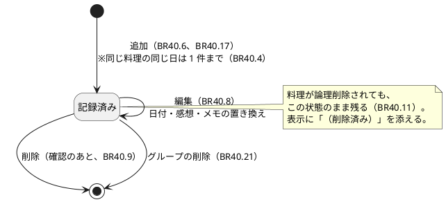
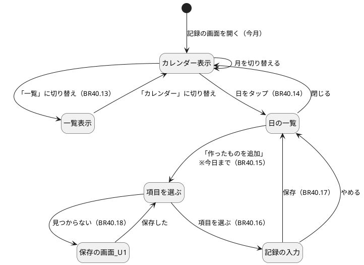
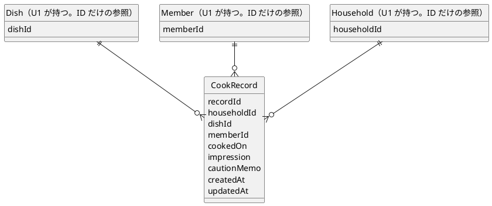

# 機能仕様：U5 作った記録（cook-log）

操作の流れ（ワークフロー）と、状態の移り変わり（状態遷移）の正（source of truth）です。データの形は `entities.md`、判断のルールは `rules.md` が正で、この文書の ER 図とルール一覧は、そこから作った読みやすい版です。技術は決めません。

## 範囲

U5 は、料理ごとに「作った日」を何回でも残し（1 対多）、感想と注意点メモを添え、カレンダーと一覧で見て、「もう作りたくない」料理を候補の後ろにずらすユニットです。含むのは、項目の詳細からの追加、記録のカレンダーと一覧、カレンダーの日付からの追加（項目を選ぶ画面）、記録の編集・削除、候補の並べ替えの拡張（U1 への足し込み）です。含まないのは、料理の保存・編集・削除・お気に入り（U1）、候補の提案そのもの（U1。U5 は並び順の判定だけを足す）、グループやアカウントの管理（U7）です。

## 用語（日本語 / 英語）

| 日本語 | 英語 | 意味 |
|---|---|---|
| ワークフロー | Workflow | 1 つの目的のために、順に行う操作の流れ |
| 状態遷移 | State transition | 「記録済み → 削除済み」のような、状態の移り変わり |
| 論理削除 | Logical delete | 消さずに「削除済み」の印を付けて、見えなくすること（料理側の方式） |
| 冪等 | Idempotent | 同じ操作を繰り返しても、結果が同じになること |
| 安定な分け方 | Stable partition | 並びの順番を保ったまま、2 つの組に分けて前後に置くこと |

## ワークフロー

### WF1. 項目の詳細から、作った日を追加する（US6.2）

1. 利用者が項目の詳細を開く。システムが、その料理の回数と作った日の一覧（新しい順）を出す（BR40.7）。
2. 「作った日を追加」を押す。作った日（初期値は日本時間の今日）を選ぶパネルが開く（BR40.6）。今日より後の日付は選べない（BR40.1）。
3. 感想（また作りたい／もう作りたくない。選ばなくてもよい）と、注意点のメモ（空でもよい）を入れる（BR40.2、BR40.3）。
4. 保存を押す。システムが次を順に確認する。
   - 料理が自分のグループにあり、削除済みでない（BR40.5）。なければ「見つからない」。
   - 作った日が実在し、今日まで（BR40.1）。未来なら `FUTURE_DATE_NOT_ALLOWED`。
   - 感想とメモの入力（BR40.2、BR40.3）。違反なら項目ごとにエラーを出す。
   - 同じ料理の同じ日の記録がない（BR40.4）。あれば `DUPLICATE_RECORD`、「この日の記録がすでにあります」と、既存の記録の編集への入口を出す。
5. 成功したら CookRecord を作る（memberId = 操作した人）。パネルを閉じ、一覧と回数を更新する。
6. 同じ料理に、何回でも繰り返せる（BR40.6）。

### WF2. 記録のカレンダーと一覧を見る（US6.4）

1. 利用者が記録の画面を開く。初期の表示は今月のカレンダー（BR40.13、BR40.22）。
2. システムが、その月の記録を取り、料理の窓口（DishCatalog.getMany）で料理名をまとめて取る。削除済みの料理も含める（BR40.11）。
3. カレンダーの各日に、料理名（短く）と感想の印を出す。1 日に複数あるときは「ほか N 件」など、件数が分かる表示にする（BR40.12）。
4. カレンダーの下に、その月の記録の一覧（作った日の新しい順）を出す（BR40.13）。
5. 「一覧」と「カレンダー」を切り替えると、それぞれの表示になる（BR40.13）。月は前後に切り替えられる。
6. 日をタップすると、その日の記録の一覧（料理・感想・注意点メモ）と、「作ったものを追加」ボタンが出る。記録のない日でも出る（BR40.14）。
7. 各記録の「記録した人」は、BR2.5 の表示名で出す。退会したメンバーは「退会したメンバー」（BR40.23）。

### WF3. カレンダーの日付から、作ったものを追加する（US6.5）

1. 利用者が日をタップし、「作ったものを追加」を押す（BR40.14）。
2. その日が今日より後なら、ボタンは押せず、「追加できるのは今日までの日付です」と出る（BR40.15）。
3. 今日まででは、項目を選ぶ画面が開く（BR40.15）。
4. 項目を選ぶ画面で、次のように探す（BR40.16）。
   - 料理名で絞り込む（文字列を含むもの）。
   - 「最近選んだもの」「お気に入り」「すべて」を切り替える。画面が「選んだもの」の一覧（U1）を取り、削除済みでない料理と突き合わせる。
5. 見つからないときは、「新しく保存する」から U1 の保存の画面へ進み、保存したあと、同じ日付の項目を選ぶ画面に戻る（BR40.18）。
6. 項目を選び、感想とメモ（どちらも任意）を入れて保存する。WF1 の手順 4 と同じ確認を行う（BR40.17）。
7. 成功したら、その日の記録として追加され、カレンダーのその日に料理名と感想の印が出る。同じ日に別の項目を続けて追加でき、同じ日に複数が並ぶ（BR40.17）。

### WF4. 記録を編集・削除する（US6.2、US6.6）

1. 利用者が、項目の詳細、または日の一覧から、記録を選ぶ。メンバーなら誰でもできる（BR40.10）。
2. 編集：作った日、感想、メモを変えて保存する（BR40.8）。
   - 作った日と入力は BR40.1〜BR40.3 で確認する。
   - 日付を変えて、同じ料理の同じ日の別の記録とぶつかるときは断り、すでにある記録を知らせる（BR40.4、自分自身を除く）。
   - 成功したら置き換わる。料理・記録した人・作った日の記録の元の作成時刻は変わらない。
3. 削除：「削除しますか？」の確認を出す（BR40.9）。「削除する」を選んだときだけ、その 1 件を消す。同じ料理の他の記録は残る。「やめる」なら何も変えない。
4. どちらの場合も、項目の詳細、カレンダー、一覧が更新された状態で表示される。
5. 他のグループの記録を指定したときは「見つからない」（BR40.10）。料理が削除済みでも、既存の記録は編集・削除できる（BR40.11）。

### WF5. 「もう作りたくない」を、候補の後ろにずらす（US6.3）

U1 の候補の提案（WF5 of U1、BR4.1）の途中に、U5 が差し込む。

1. U1 が、候補（削除済みでなく、選んだものでなく、見た料理でもない料理）を作る。
2. 候補の提案が、候補の料理の ID を**まとめて** CookLog に渡し、最新の感想を聞く（BR40.19）。
3. CookLog が、料理ごとに「作った日が最も新しい記録」1 件の感想を `again` / `never_again` / `none` で答える。記録がない、または最新の記録に感想がなければ `none`。
4. 候補の提案が、`never_again` でない料理を前、`never_again` の料理を後ろにする（BR40.20）。それぞれの中の順番は、U1 の順番（ランダム）のまま変えない。
5. ずらした順で、候補を 1 件ずつ見せる。後ろにずらしただけで、候補から外しはしない。
6. 記録を追加・編集・削除すると、次に候補を取るときから、その結果が反映される（以前は `never_again`、最新が `again` なら、ずらされない。BR40.19）。
7. 聞くのに失敗したときは、並べ替えをせず、U1 の順番のまま出す（BR40.20）。

### WF6. 料理の削除とグループの削除（BR40.11、BR40.21）

1. 料理が論理削除されても、その料理の CookRecord には手を加えない（ADR-008）。カレンダーと一覧には料理名に「（削除済み）」を添えて残す。新しい記録の追加は断る（BR40.5）。
2. グループが削除されると、household.created と同じ仕組みで household.deleted が届く（契約 C3）。CookLog が、その householdId の記録をすべて消す（BR40.21）。同じ出来事を何度受けても、結果は同じ（冪等）。

## 状態遷移

### ST1. CookRecord（作った記録）

### ST2. 記録の画面（画面側の状態）

## ER 図（entities.md から作った読み取り用の図）

## ルールの概要（rules.md から作った読み取り用の一覧）

| グループ | 内容 | ルール |
|---|---|---|
| 入力 | 作った日（今日まで・上限なし）、感想、メモ | BR40.1〜BR40.3 |
| 二重登録と対象 | 同じ日の同じ料理は 1 件、追加できる料理の条件 | BR40.4〜BR40.5 |
| 追加・一覧・編集・削除 | 項目の詳細から追加、回数と一覧、編集、削除 | BR40.6〜BR40.9 |
| 範囲と削除済みの料理 | グループの範囲、誰でも編集・削除、料理が削除されても記録は残る | BR40.10〜BR40.11 |
| カレンダー | 料理名と印、月の一覧、日のタップ、未来は追加不可 | BR40.12〜BR40.15 |
| 項目を選ぶ | 絞り込みと 3 つの切り替え、保存、見つからなければ保存の画面へ | BR40.16〜BR40.18 |
| 候補への反映 | 最新の感想、「もう作りたくない」を後ろへ | BR40.19〜BR40.20 |
| その他 | グループ削除で消す、日本時間、記録した人の表示 | BR40.21〜BR40.23 |

## 他のユニットとの境界

| 相手 | U5 での扱い |
|---|---|
| U1（最小の通し版） | 料理の存在確認と料理名の取得は DishCatalog（C2）を使う。候補の提案の並び順に、最新の感想（CookLogImpression の本物の実装）を足す。U1 の既定の実装（すべて `none`）を差し替える。U1 のルール（BR4.1 など）は書き換えない。保存の画面（BR3.13）は U1 のものを使う |
| U4（献立） | 献立の提案も SuggestionJudge の並び順（BR40.20）を通して、同じ並べ替えを使う。U4 から U5 を直接呼ばない。U5 がなくても U4 は動く（並べ替えなし） |
| U7（管理） | household.deleted を出す側は U7。受け口（BR40.21）は U5 が作る。退会・アカウント削除のとき、記録は残り、名前は「退会したメンバー」になる（BR40.23） |
| U3（買い物リスト）、U2、U6 | 関わらない。ただし「最近選んだもの」の元になる「選んだもの」（U1）は、U3 が買い物リスト作成の完了で外すことがある（BR40.16） |

## 根拠（Sources）

- [Q1〜Q6] `functional-design-questions.md` の回答（すべて A）
- [scope] `unit-of-work.md`、`unit-of-work-story-map.md`（U5 の担当ストーリー）、`stories.md`（US6.2〜US6.6）
- [memory] ADR-005、ADR-006、ADR-007、ADR-008、ADR-009
- [scope] `contract-summary.md`（C1 の記録の窓口、C2 の CookLogImpression と DishCatalog、C3 の household.deleted、日本時間の規則）
- [scope] U1 の機能設計（`entities.md`、`rules.md`、`functional-spec.md`）

## Assumptions & Open Questions

- [assumption] 「最近選んだもの」（US6.5）は、買い物前で「これにする」を押した「選んだもの」の料理とした（Q6 A）。「選んだもの」は買い物リストの作成が終わると外れる（U3）ので、そのあとは「最近選んだもの」から消える。「最近作った料理」を指す意図だった場合は、BR40.16 を見直す（別の案：最近の記録の料理を新しい順に出す。U5 だけで作れる）。
- [assumption] 記録の画面の「料理名（短く）」は 8 文字までとし、超える分は省く（BR40.12）。画面の幅に合わせた最終の文字数は、コード生成で決める。
- [assumption] 1 日に複数の記録があるときの表示は、先頭 1 件の料理名と「ほか N 件」とした（BR40.12）。見た目の細部（色や印の形）は画面の設計で決める。
- [assumption] 感想を後ろにずらすのは候補の並び順だけ（FR6.4）。「おまかせ」（FR2.8）の抽選には反映しない。U4 の献立の提案には、SuggestionJudge を通して同じ並べ替えが効く（unit-of-work.md の U5 と U4 の関係のとおり）。
- [assumption] 最新の記録に感想がないときは「感想なし」とし、前の記録の感想にさかのぼらない（Q4 A）。
- OQ1 要件の OQ11（保存した項目にない料理を、料理名だけで保存できるか）は、U1 の保存の画面の仕様で、このユニットは変えない。BR40.18 は、現在の保存の画面（URL と料理名が必要）へ案内する。
- OQ2 要件の OQ12 のうち、献立（S8）の各日や「選んだもの」から直接「作った」を記録する入口は、このユニットでは足さない。必要なら 1st バージョンを触ってから決める。
