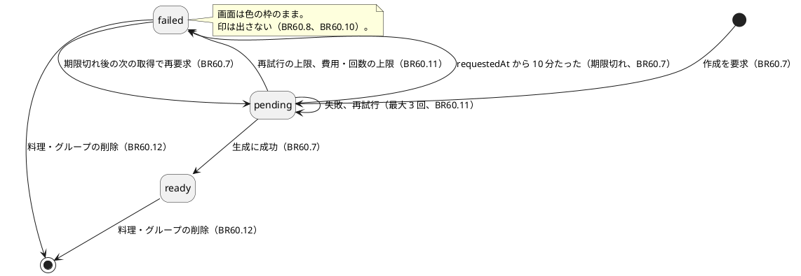
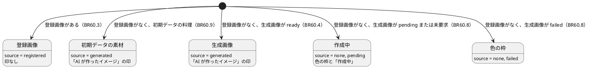
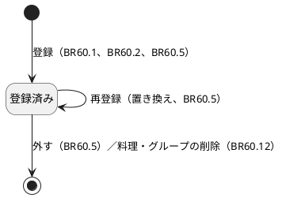
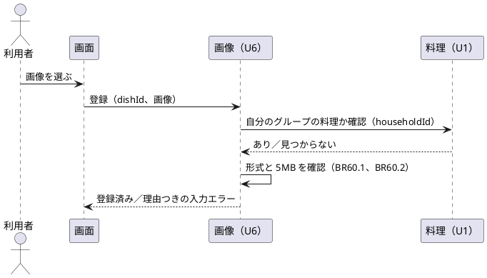
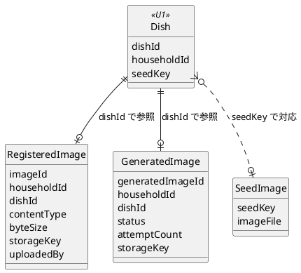

# 機能仕様：U6 画像

操作の流れ（ワークフロー）と、状態の移り変わり（状態遷移）の正（source of truth）です。データの形は `entities.md`、判断のルールは `rules.md` が正で、この文書の ER 図とルール一覧は、そこから作った読みやすい版です。技術は決めません。

## 範囲

U6 は、料理のイメージ画像を見せる・登録する部分です（US1.5、AC9.1.7、AC9.1.8）。

- **通し版で本実装する**：利用者が登録する画像（形式と 5MB の確認、置き換え、外す、グループの範囲に限る）、「AI が作ったイメージ」の印、作成中・失敗の表示、初期データの画像素材。
- **通し版では代える**：生成 AI のサービスは未決定（OQ7）。差し替えられる入口（C4 の ImageGeneratorPort）を設計し、通し版の実装は、ローカルで作る固定の絵（ダミー。料理名から色を決める）にする。サービスが決まったら、ポートの実装だけを差し替える。
- **含まない**：生成 AI のサービスの選定、費用の上限の値、安全面（OQ7）。料理の保存そのもの（U1）。

## 用語（日本語 / 英語）

| 日本語 | 英語 | 意味 |
|---|---|---|
| 登録画像 | Registered image | 利用者が登録した画像 |
| 生成画像 | Generated image | 生成 AI（通し版ではダミー）が作った画像。印を付ける |
| ポート | Port | 外部サービスを差し替えられる、自分たちの側の入口 |
| 冪等 | Idempotent | 同じ操作を繰り返しても、結果が同じになること |

## ワークフロー

### WF1. 画像を登録する（US1.5 / AC1.5.2、AC1.5.3）

1. 利用者が、料理の保存または編集の画面で、画像（スクリーンショットなど）を選ぶ。新しい料理の保存画面では dishId がまだないので、2 段階にする：先に料理を保存し（U1）、保存が成功したら、その dishId で画像を登録する。画像が入力エラー（手順 3、4）のときも、料理は保存済みのままとし、編集画面で理由を示して再登録できる（BR60.5）。
2. システムがログイン状態から householdId を決め、dishId が自分のグループの削除済みでない料理か確かめる（BR60.6）。違えば「見つからない」。
3. ファイルの中身から形式を判定する。画像でなければ、「画像ではありません」と表示して止める（BR60.1）。
4. 大きさが 5MB を超えていれば、「5MB を超えています」と表示して止める（BR60.2）。このとき、すでにある登録画像は変わらない。
5. 画像の実体を保管し、RegisteredImage を作る。すでに登録画像があれば置き換え、古い実体を消す（BR60.5）。
6. 以後、その料理は登録画像を表示し、生成画像と印は出さない（BR60.3）。

### WF2. 登録画像を外す（US1.5 / AC1.5.2 の裏返し）

1. 利用者が編集の画面で「画像を外す」を押す。
2. グループの確認のあと（BR60.6）、RegisteredImage と実体を消す（BR60.5）。
3. 以後、その料理は生成画像（あれば）の表示に戻る（BR60.4）。なければ WF3 で要求する。

### WF3. 画像を見る（US1.5 / AC1.5.1、AC9.1.7）

1. 画面（候補、詳細、一覧）が、料理の画像の状態を取りに来る。
2. システムが householdId で絞る（BR60.6）。
3. 登録画像があれば、source = registered、isAiGenerated = false を返す（BR60.3）。
4. なければ、初期データの料理(seed)は SeedImage を generated として返す（BR60.9）。
5. それ以外の料理で GeneratedImage が ready なら、generated として返し、画面は「AI が作ったイメージ」の印を付ける（BR60.4、BR60.10）。
6. GeneratedImage がなければ、作成を要求して（WF4）、pending（色の枠と「作成中」）を返す（BR60.7、BR60.8）。pending なら pending のまま、failed なら色の枠のままを返す。
7. 画面は、pending のあいだ、少し間を置いて取り直す（BR60.8）。画面の応答は待たせない。

### WF4. 生成画像を作る（裏の処理。US1.5 / AC1.5.1）

1. 料理の保存・編集の直後、または WF3 の手順 6 で、`ImageRequest.requestGeneration(dishId)` が呼ばれる。すぐ accepted を返す（BR60.7）。
2. 登録画像がある、または同じ dishId の GeneratedImage がすでにあれば、何もしない（冪等）。
3. GeneratedImage（pending）を作る。
4. 料理名と材料から短い文を作り、ImageGeneratorPort.generate を呼ぶ。通し版はダミー（固定の絵）を返す。
5. 成功なら、実体を保管し、GeneratedImage を ready にする。
6. 失敗なら、間を置いて再試行する（最大 3 回）。回数や費用の上限に達したら failed にし、運用者が分かる形で記録する（BR60.11）。

### WF5. 料理・グループの削除に画像を連動させる（設計の判断）

1. 料理が削除されたとき、`ImageRequest.deleteForDish(dishId)` が呼ばれる。登録画像と生成画像と実体を消す（BR60.12）。
2. グループが削除されたとき（household.deleted）、そのグループの画像をすべて消す。何度受けても結果は同じ。SeedImage は共有なので消さない。

### WF6. 初期データの画像の入れ替え（開発時。US9.1 / AC9.1.8）

1. 開発者が、初期データのデータファイルと、seedKey に対応する画像素材を差し替える。プログラムは変えない。
2. 新しいグループは、差し替えたあとの料理と画像で始まる。既存のグループの表示も、素材を共有しているため、以後の表示で素材が変わる（BR60.9）。
3. 素材が不足、または形式・大きさが範囲外の料理は、色の枠にして記録する。ほかの料理には影響しない。

エラーの流れ：他のグループの dishId は、存在しないものとして「見つからない」（BR60.6）。未ログインは「未ログイン」。

## 状態遷移

### ST1. GeneratedImage（生成画像の作成の状態）

### ST2. 料理の画像の表示（DishImage の決まり方）

### ST3. RegisteredImage（登録画像）

### 画像を登録するときの流れ（概要）

## ER 図（entities.md から作った読み取り用の図）

## ルールの概要（rules.md から作った読み取り用の一覧）

| ルール | 内容 |
|---|---|
| BR60.1〜BR60.2 | 画像だけ（中身で判定）、5MB 以下 |
| BR60.3〜BR60.5 | 登録画像を優先、なければ生成画像と印、1 料理 1 枚 |
| BR60.6 | グループの範囲に限る、他のグループは「見つからない」 |
| BR60.7〜BR60.8 | 生成は差し替えられる入口を通して裏で行う、作成中・失敗は色の枠 |
| BR60.9 | 初期データの画像素材（差し替えはファイルだけ） |
| BR60.10〜BR60.11 | 印は生成画像にだけ、失敗の再試行と上限 |
| BR60.12〜BR60.14 | 削除の連動、ID だけの参照、代わりの文字 |

## 他のユニットとの境界

| 相手 | U6 での扱い |
|---|---|
| U1（料理） | ImageRequest（C2）の窓口の定義と既定の実装（何もしない）は U1。U6 が本物の実装に差し替える。U1 は料理に画像の項目を持たず、U6 が dishId で結びつける。画面（カード、詳細、保存・編集）は DishImage を表示する |
| U7（管理） | household.deleted を出す側は U7。受ける側の受け口（画像の削除）は U6 が作る（BR60.12） |
| 生成 AI（C4） | サービスは未決定（OQ7）。通し版はダミー。サービスの選定、費用の上限、安全面は、決まったときに BR60.11 の設定とポートの実装を足す |

## 根拠（Sources）

- [Q1〜Q5] `functional-design-questions.md` の回答（すべて A）
- [scope] `unit-of-work.md`、`unit-of-work-story-map.md`（U6 の担当ストーリー US1.5）
- [memory] ADR-005、ADR-007、ADR-008、ADR-009
- [scope] `contract-summary.md`（C1 の DishImage、C2 の ImageRequest、C4 の ImageGeneratorPort）

## Assumptions & Open Questions

- [assumption] 通し版では、生成 AI の代わりにダミーの画像（料理名から色を決める固定の絵）を使う。理由：サービスが未決定（OQ7）で、デモで見せるため。サービスが決まったらポートの実装だけを差し替える。
- [assumption] 初期データの画像は、グループごとに複製せず、読み取り専用で共有する（Q4 A）。AC9.1.8 の「新しいグループに反映」は、新しいグループが同じ素材を参照することで満たす。
- OQ1 契約 C2 の ImageRequest は、入力が dishId だけ。生成の文（料理名、材料）と初期データの seedKey を U6 が得るには、料理（U1）に householdId つきで問い合わせる窓口が要る。Code Generation で、U1 の既存の窓口で足りるか確かめ、足りなければ契約を更新する。
- OQ2 契約 C1 の画像 GET は、画像の状態（url つき）を返す。url が指す画像の実体を取る窓口は契約にない。Code Generation で、グループの確認つきの窓口として足す（BR60.6）。
- OQ3 契約 C1 の DishImage.status は ready / pending / failed で、source が none の扱いは明記がない。この設計は「source = none かつ status = pending または failed」とした。
- OQ4 費用と回数の上限、サービス、安全面は未決定（OQ7）。BR60.11 は設定として外に出す。
