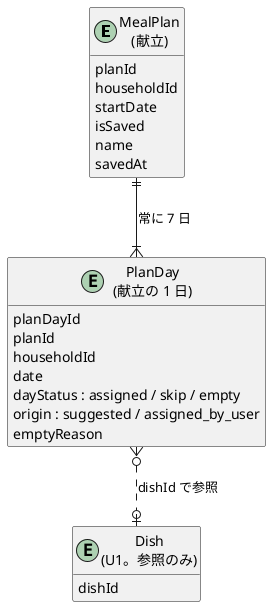
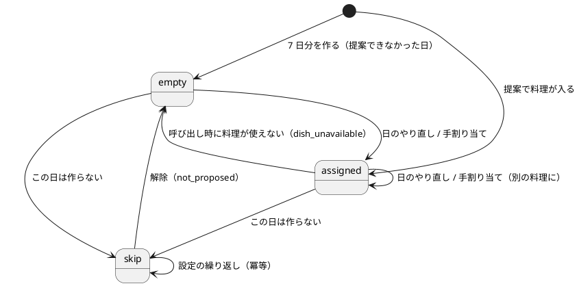
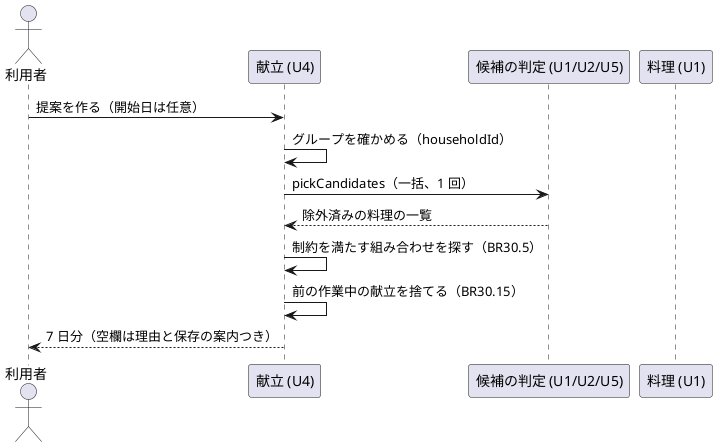
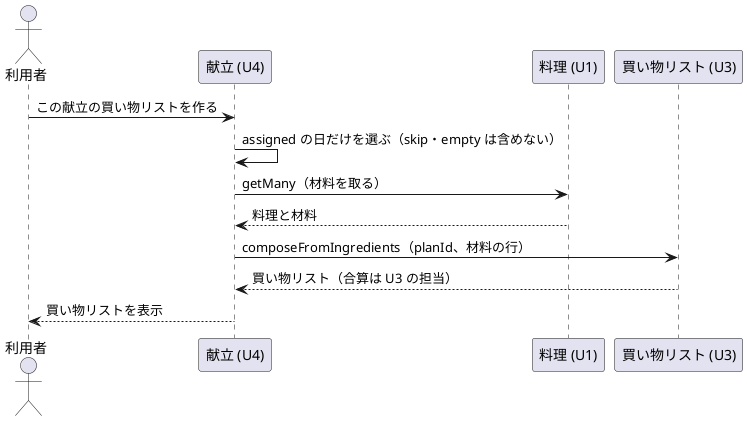

# 機能仕様：U4 献立（meal-plan）

操作の流れ（ワークフロー）と、状態の移り変わり（状態遷移）の正（source of truth）です。データの形は `entities.md`、判断のルールは `rules.md` が正で、この文書の ER 図とルール一覧は、そこから作った読みやすい版です。技術は決めません。図は PlantUML で書きます。

## 範囲

U4 は「1 週間（7 日分）の献立」を扱います。含むのは、提案、日ごと・週全体のやり直し、足りない日の空欄、保存と呼び出し、「この日は作らない」の設定・解除、「選んだもの」の日への割り当て、この献立の買い物リストへの材料の受け渡しです。含まないのは、好き嫌いの登録と除外の仕組み（U2）、買い物リストの集計（U3）、作った記録による並び替え（U5）、料理の保存と編集（U1）です。U4 はそれらを「呼ぶ側」です。

## 根拠（Sources）

- [Q1〜Q6] `functional-design-questions.md`（すべて A）
- [stories] US5.1〜US5.6、AC9.1.6
- [contract] C2：SuggestionJudge（pickCandidates、listPicked）、DishCatalog（getMany）、ShoppingListCompose（composeFromIngredients）

## 用語（日本語 / 英語）

| 日本語 | 英語 | 意味 |
|---|---|---|
| 作業中の献立 | Working plan | まだ保存していない、いま編集している献立。グループにつき 1 件 |
| 保存済みの献立 | Saved plan | 保存した献立。日の内容は変わらない |
| 空欄 | Vacancy（empty） | 料理がない日。理由を持つ |
| 作らない日 | Skip day | 外食・惣菜などで、料理を入れない日 |
| 冪等 | Idempotent | 同じ操作を繰り返しても、結果が同じになること |

## 呼び出す先（U4 が使う窓口）

| 窓口 | 提供 | U4 が使うもの | 渡す値 |
|---|---|---|---|
| SuggestionJudge.pickCandidates | Suggestion（U1。除外は U2、並び順は U5 が足す） | 除外済み・並び替え済みの料理の一覧（1 回で一括） | CallContext（householdId、memberId） |
| SuggestionJudge.listPicked | Suggestion（U1） | 「選んだもの」の一覧 | CallContext |
| DishCatalog.getMany | Dish（U1） | 表示用の料理（削除済みも含む、材料・食材の種類つき） | CallContext、dishId の一覧 |
| ShoppingListCompose.composeFromIngredients | ShoppingList（U3） | （U4 から渡す側）材料の一覧 | CallContext、source = mealPlan(planId)、材料の行 |

## エンティティの関係（ER 図。entities.md から作った版）



## 状態遷移

### PlanDay（献立の 1 日）



### MealPlan（献立）

```plantuml
@startuml
[*] --> Working : 提案を作る / 呼び出す
Working --> Working : やり直し・割り当て・作らない・解除
Working --> Saved : 保存する
Working --> [*] : 新しい提案・呼び出しで捨てられる / グループ削除
Saved --> Saved : 保存の繰り返し（冪等）
Saved --> [*] : グループ削除
Saved ..> Working : 呼び出す（写しを作る。Saved は変わらない）
@enduml
```

## ワークフロー

### WF1. 1 週間の献立を提案する（US5.1、US5.3、AC9.1.6）



1. 利用者が、開始日（任意）を添えて「提案を作る」。システムが入口でグループを確かめる（BR30.20）。
2. 候補の判定に householdId を付けて 1 回だけ問い合わせ、削除済みでない全部の料理（選んだものも含む）から除外済みを除いた一覧を受け取る（BR30.2）。
3. 開始日から連続する 7 日の PlanDay を作る（BR30.1）。
4. 制約（BR30.3、BR30.4）を満たす組み合わせを探して当てはめる。行き詰まったら前の日に戻る（BR30.5）。
5. 当てはめられなかった日は空欄にし、理由を付ける（BR30.8）。探索の上限に達したら残りを空欄にする（BR30.7）。
6. 作業中の献立がすでにあれば捨て、新しい献立を作業中にする（BR30.15）。
7. 7 日分を表示する。空欄の日には、理由と「料理を保存する」への入口を出す。作らない日と空きの数は別に数える（BR30.13）。

エラーの流れ：料理が 0 件のときは、7 日すべてが空欄（not_enough_dishes）で、保存の案内を出す（BR30.8）。

### WF2. やり直し（US5.2）

日ごと：
1. 利用者が日を選んで「この日をやり直す」。
2. skip の日なら断る（BR30.9）。
3. 他の 6 日を動かさずに、その日に入れられる別の料理を探す（BR30.9）。見つかれば置き換える。見つからなければ今のまま、案内を出す。

週全体：
1. 利用者が「週全体をやり直す」。
2. 作らない日を固定して、残りの日に WF1 の手順 2〜5 をやり直す（BR30.12）。
3. 直前と同じ並びにならないようにする。別の組み合わせがないときは、案内を出す。

### WF3. 「この日は作らない」の設定と解除（US5.5）

1. 設定：日を選んで「この日は作らない」。料理があれば外れ、その日は skip になる（BR30.10）。空きの数には数えない（BR30.13）。
2. 解除：skip の日を選んで「作る日に戻す」。その日は空欄（not_proposed）になる（BR30.11）。
3. 解除した日に、日のやり直し（BR30.9）または手割り当て（BR30.17）をすると、料理が入る。
4. 保存済みの献立には、設定も解除もできない（BR30.14）。

### WF4. 選んだものを日に割り当てる（US5.6）

1. 献立の画面を開くと、「選んだもの」が候補として並ぶ（BR30.16）。0 件なら「買い物前で選ぶ」への入口を出す。
2. 利用者が、候補の 1 つを日に割り当てる。
3. skip の日と、すでに 2 日に入っている料理は断る（BR30.17、BR30.3）。
4. 食材の種類が 3 日続くときは、注意を出して割り当てる（BR30.4）。
5. その日が assigned（assigned_by_user）になる。

### WF5. 保存と呼び出し（US5.4）

1. 保存：作業中の献立を「保存する」。名前を付けて保存済みになる（BR30.14）。保存済みの一覧に載る。
2. 呼び出し：一覧から選ぶと、写しが作業中の献立として開く（BR30.15）。前の作業中の献立があれば、捨てる前に確認する。
3. 写した日のうち、料理が削除済み・除外されていた日は空欄（dish_unavailable）にして理由を示す（BR30.15、BR30.21）。
4. 利用者が変更しても、保存済みの元は変わらない。もう一度「保存」すると別の保存済みの献立になる。

### WF6. この献立の買い物リストを作る（US5.5 AC5.5.2）



1. 利用者が「この献立の買い物リストを作る」。
2. assigned の日の料理だけを選ぶ。skip の日と空欄の日は含まれない（BR30.18、AC5.5.2）。
3. 削除済みの料理の日は含めず、案内を出す（BR30.18、BR30.21）。
4. 材料の行を買い物リストの窓口に渡す。合算は U3 が行う。assigned の日が 0 件なら作らず、案内を出す。

## 提案の決め方を検証する（BR30.5 の確かめ方）

乱数を固定して、次を確かめます（コード・方法は Code Generation で決める）。

| # | 確かめること | 期待 |
|---|---|---|
| V1 | 初期データだけのグループで、乱数列を変えて何回提案しても | 空欄 0 件、同じ料理は 1 回まで、同じ種類が 3 日続かない（AC9.1.6） |
| V2 | 除外した食材を含む料理がある状態で提案する | その料理は含まれない（AC5.1.4） |
| V3 | 削除済みでない料理が 5 件だけのとき（うち 3 件が「選んだもの」でも） | 選んだものを除かず、5 日分が埋まり、2 日が not_enough_dishes の空欄（AC5.3.1） |
| V3a | 「選んだもの」の料理を日に割り当て、保存して呼び出す | その日は assigned のまま。選んだものであることでは dish_unavailable にならない（削除済み・除外のときだけ変わる）（BR30.15） |
| V4 | 「作らない」を 2 日設定して提案する | その 2 日は skip。空きの数に数えない（AC5.5.3） |
| V5 | 同じ種類の料理だけ 4 件と、他の種類 4 件のとき | 同じ種類が 3 日続く並びは作られない（AC5.1.3） |
| V6 | 日のやり直し | 他の 6 日は同じ、その日の料理は変わる（AC5.2.1） |
| V7 | 週全体のやり直し | 作らない日は保たれ、並びは直前と同じにならない（AC5.2.2） |
| V8 | 保存してから呼び出して変更 | 保存済みの元は変わらない（AC5.4.2） |
| V9 | 保存した料理が 200 件のとき | 3 秒以内（AC5.1.5。測り方は NFR Requirements） |
| V10 | 作らない日がある献立の買い物リスト | その日の料理の材料が渡されない（AC5.5.2） |

## ルールの一覧（rules.md から作った版）

BR30.1〜BR30.22 の一覧は `rules.md` の「ルールの概要」を参照してください。

## 要確認（上流・他ユニットとの間）

1. **Dish.ingredientKind の追加**：U1 の Dish にない。料理の持ち主（U1）の変更として、Code Generation で足す（entities.md の「他のユニットに求める追加」、BR30.19）。
2. **献立用の候補の取得（決定済み）**：献立の母集団は「削除済みでない全部の料理（除外・並び替え後）」で、「選んだもの」を除かない。U1 の BR4.1 の「選んだものを除く」は買い物前の 1 件ずつの表示専用。U4 の Code Generation の作業として、U1 側に「選んだものを除かない候補の一覧を返す入口」（例：`listCandidateIds` に `includePicked` の指定。献立は `includePicked: true`）を足し、pickCandidates から使えるようにする。
   **並び順の層（未決）**：SuggestionJudge.pickCandidates が「後ろにずらした料理」を区別できる形で返すか、契約に書かれていない（rules.md の補足）。
3. **材料の受け渡しの形**：契約の ShoppingListCompose は `Ingredient[]` を受け取る。材料が未入力の料理を知らせる方法（料理名だけの行を渡す）は、U3 の機能設計と合わせる（BR30.18）。
4. **同じ料理の使い方**：要件 FR5.3 は「2 回まで」だが、AC5.3.1 に合わせて、提案では 1 回までとし、2 回までは手割り当てだけにした（Q4 A）。
