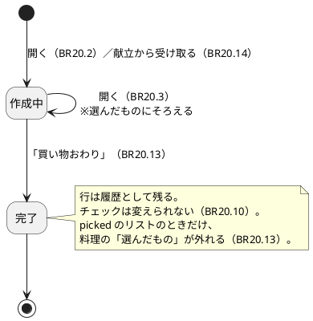
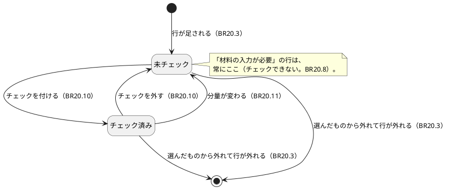
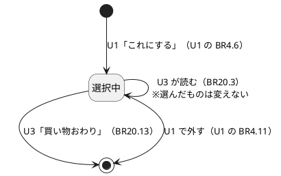
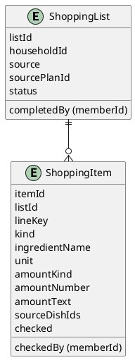

# 機能仕様：U3 買い物リスト
操作の流れ（ワークフロー）と、状態の移り変わり（状態遷移）の正（source of truth）です。データの形は `entities.md`、判断のルールは `rules.md` が正で、この文書の ER 図とルール一覧は、そこから作った読みやすい版です。技術は決めません。

## 範囲
U3 は「これにする」で選んだものの材料を、買い物リストにまとめるユニットです。含むのは、選んだものからのリスト作成と同期、材料の合算、材料が未入力の料理の案内、チェックの付け外しと保存、「買い物おわり」での完了、献立（U4）から材料を受け取る受け口です。含まないのは、「選んだもの」を持つこと・外す操作そのもの（U1）、献立の画面と「作らない日」の判断（U4）、食材名の正規化と単位の換算（しない）です。

## 用語（日本語 / 英語）
| 日本語 | 英語 | 意味 |
|---|---|---|
| 合算 | Aggregate | 同じ材料・同じ単位の分量を足して 1 行にすること |
| 同期 | Sync | 「選んだもの」の今の状態に、リストの中身をそろえること |
| 同一性の印 | lineKey | 「この行と、この行は同じ行」と判断するための印 |
| 冪等 | Idempotent | 同じ操作を繰り返しても、結果が同じになること |

## ワークフロー
### WF1. 買い物リストを開く（US2.6、US3.1）
1. 利用者が、ホームから買い物リストを開く。入口で、グループの所属が確認される（ADR-005）。
2. 作成中の picked のリストがなければ、1 件作る（BR20.2）。
3. U1 の窓口から、このグループの「選んだもの」を取る（削除済みの料理は除かれている）。
4. 料理の窓口から、選んだ料理の材料と分量を取る。
5. あるべき行の一覧を作る（BR20.4〜BR20.8）。
   - 数として扱える分量で、材料名・単位が同じものは足して 1 行（BR20.5）。単位が違えば別の行（BR20.6）。
   - 数でない分量・分量が空のものは、料理ごとに別の行（BR20.7）。
   - 材料が 0 行の料理は「材料の入力が必要」の行（BR20.8）。
6. 今の行とくらべ、足す・外す・残すを決める。分量が変わった行はチェックを外し、同じ行はチェックを引き継ぐ（BR20.3、BR20.11）。1 つの処理として反映する。
7. 並べて表示する（BR20.9）。行が 0 件なら「買い物リストは空です」と、候補を見る画面への入口を出す（BR20.12）。
8. 失敗したときは、前回保存した内容を出し、「最新の状態にできませんでした」と知らせる（BR20.3）。

### WF2. 買い物中にチェックを付ける・外す（US3.2）
1. 利用者が、材料の行をタップする。
2. システムが、行の householdId を確認する（BR20.1）。「材料の入力が必要」の行と、完了したリストの行は受け付けない（BR20.8、BR20.10）。
3. 行の checked を、指定の値（付ける / 外す）にする。付けるときは、チェックした人（memberId）と時刻を記録する（BR20.10）。
4. 保存できたら、画面を更新する。失敗したら、画面を元に戻して「保存できませんでした」と知らせる。
5. 再表示しても、別のメンバーが開いても、チェックは残る（NFR4.1）。

### WF3. 選びなおす（US2.6）
1. 利用者が、U1 の画面で「これにする」を押す、または「選んだもの」から外す（U1 の BR4.6、BR4.11）。
2. 次に買い物リストを開いたとき、WF1 により、材料が足される、または外れる（BR20.3）。
3. 分量が変わった行は、チェックが外れる（BR20.11）。

### WF4. 「買い物おわり」で完了する（U1 の ST2 の受け口）
1. 利用者が、「買い物おわり」を押す。チェックがすべて付いていなくてもよい（BR20.13）。
2. システムが、WF1 の手順 3〜6 で、リストを今の「選んだもの」にそろえる。
3. リストを完了にする（完了した人の memberId と時刻を記録）。行は履歴として残す。
4. このリストの料理の「選んだもの」を、U1 の窓口で外す。外す対象の料理は、完了と同時に unpickDishIds に保存しておく。全部外せたら unpickDone = true にする。外せなかった分は、次に「買い物おわり」またはリストを開く操作があったとき、同期より先に再び外す。やり直しは、完了時刻以前から選ばれていたものに限り、完了後に選び直したものは外さない（BR20.13、BR20.3）。
5. 次に買い物リストを開いたとき、新しい作成中のリストが作られる（BR20.2）。

### WF5. 献立から材料を受け取る（ADR-010）
1. 献立（U4）が、householdId、献立の ID、材料の一覧（「作らない」日の料理を除いたもの）を渡す。
2. システムが、BR20.4〜BR20.8 と同じ規則で、source = mealPlan のリストを作る（BR20.14）。同じ献立の ID の作成中のリストがあれば、中身を置き換え、チェックを引き継ぐ。
3. 結果のリストを U4 に返す。「選んだもの」のリストには触れない。

### WF6. グループが削除されたとき（ADR-007）
1. 「グループが削除された」出来事を受ける。
2. そのグループの買い物リストと行をすべて消す（BR20.15）。何度受けても結果は同じ。

## 状態遷移
### ST1. ShoppingList（買い物リスト）

### ST2. ShoppingItem（リストの行）

### ST3. U1 の PickedItem との関係（受け口）

## 図：エンティティの関係（entities.md から作った読み取り用）

## 集計の例（読み取り用。ルールの正は rules.md）
| 選んだ料理と材料 | 結果の行 | ルール |
|---|---|---|
| A：玉ねぎ 2 個、B：玉ねぎ 1 個 | 玉ねぎ 3 個（A、B） | BR20.5 |
| A：玉ねぎ 2 個、B：玉ねぎ 200 g | 玉ねぎ 2 個 / 玉ねぎ 200 g（別の行） | BR20.6 |
| A：塩 少々、B：塩 少々 | 塩 少々（A）/ 塩 少々（B）（別の行） | BR20.7 |
| A：醤油（分量なし） | 醤油（A） | BR20.7 |
| C：材料が 0 行 | C：材料の入力が必要 | BR20.8 |
| 選んだものが 0 件 | 買い物リストは空です | BR20.12 |

## ルールの概要（rules.md から作った読み取り用の一覧）
| グループ | 内容 | ルール |
|---|---|---|
| 範囲 | グループで絞る | BR20.1 |
| 作成 | 1 グループ 1 件、開くたびにそろえる、材料は全部入る | BR20.2〜BR20.4 |
| 集計 | 合算、単位違い、数でない分量 | BR20.5〜BR20.7 |
| 案内 | 材料の入力が必要、並び順、空の表示 | BR20.8、BR20.9、BR20.12 |
| チェック | 保存・共有・冪等、同期での引き継ぎ | BR20.10、BR20.11 |
| 完了・受け口 | 買い物おわり、献立からの受け取り、グループ削除 | BR20.13〜BR20.15 |
| 参照・性能 | memberId のみ、1 秒以内・横スクロールなし | BR20.16、BR20.17 |

## 他のユニットとの境界
| 相手 | U3 での扱い |
|---|---|
| U1（最小の通し版） | 「選んだもの」の一覧と、外す操作は U1。U3 は読むだけで、「買い物おわり」のときだけ、外す窓口を呼ぶ。料理の材料も U1 の料理の窓口から読む |
| U4（献立） | 献立が材料を渡す（ADR-010）。U3 は献立を知らない。「作らない日の料理を含めない」判断は U4。献立用のリストの画面は U4 |
| U7（管理） | グループ削除の出来事を出すのは U7。受ける U3 の受け口は BR20.15 |
| U2、U5、U6 | かかわらない（U3 が U2 を待つ必要はない。unit-of-work.md の OQ1 のとおり） |

## 根拠（Sources）
- [Q1〜Q6] `functional-design-questions.md` の回答（すべて A）
- [scope] `unit-of-work.md`、`unit-of-work-story-map.md`（U3 の担当ストーリー）
- [scope] U1 の `functional-spec.md`（ST2、他のユニットとの境界）
- [memory] ADR-005、ADR-007、ADR-008、ADR-009、ADR-010
- [scope] `contract-summary.md`（ShoppingListCompose、SuggestionJudge、DishCatalog）

## Assumptions & Open Questions
- [assumption] 買い物リストは、グループで 1 つを共有する（「選んだもの」がグループ共有のため）。メンバーごとのリストは作らない。
- [assumption] 数として扱う分量は、整数・小数・単純な分数（1/2）に限る。「2〜3」「1 と 1/2」のような書き方は、数でない分量として別の行になる。
- [assumption] 分量が「0」（0、0.0 など）は、数として扱わず、料理ごとの別の行にする（合算しない）。質問にない決定なので、承認で確認する。
- [assumption] 数の分量の表示は、整数なら整数、割り切れない小数は小数第 2 位まで四捨五入とする。質問にない決定なので、承認で確認する。
- [assumption] 「買い物おわり」の外し残しは、完了時に外す対象の料理（unpickDishIds）を保存して覚え、やり直しは完了時刻以前から選ばれていたものに限る。リストを開くときは、やり直しを同期より先に行う（BR20.13、BR20.3）。
- OQ1 U3 が「選んだものを外す」ために U1 の窓口を呼ぶ形が、`contract-summary.md` の SuggestionJudge には書かれていない（読むための listPicked のみ）。U1 の BR4.11（外す操作）と同じ処理を U3 が使う窓口を、コード生成の前に確認し、必要なら Contract Design の窓口に追記する。
- OQ2 `components.md` の ShoppingItem は sourceDishId（1 件）、quantity（1 つ）だが、この設計は sourceDishIds（複数）、amountKind / amountNumber / amountText に変えた（合算した行が複数の料理から来るため）。上流の更新が要るか、確認する。
- OQ3 完了した買い物リストの履歴の閲覧画面と保存期間は決めていない（1st バージョンでは、完了後に新しいリストが始まるだけ）。
