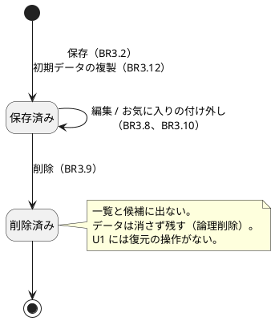
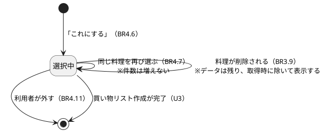
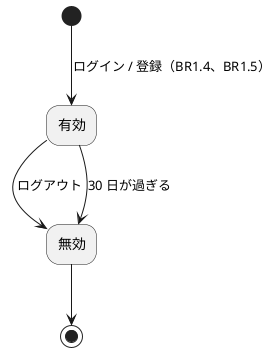
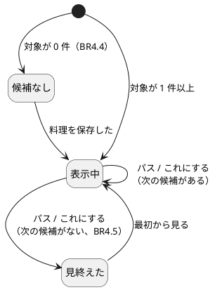
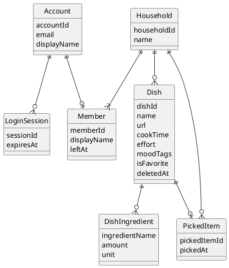

# 機能仕様：U1 最小の通し版

操作の流れ（ワークフロー）と、状態の移り変わり（状態遷移）の正（source of truth）です。データの形は `entities.md`、判断のルールは `rules.md` が正で、この文書の ER 図とルール一覧は、そこから作った読みやすい版です。技術は決めません。

## 範囲

U1 は「出会いを保存して、買い物前に見る」の中心を、端から端まで動かす最小の版です。含むのは、登録とログイン、グループの作成、初期データ 30 件、料理の保存・編集・削除・お気に入り、買い物前の候補（スワイプ）と「選んだもの」です。含まないのは、好き嫌いの除外・絞り込み（U2）、買い物リスト（U3）、画像（U6）、招待・脱退・削除・パスワード再設定・ログインの制限（U7）、作った記録による並べ替え（U5）です。

## 用語（日本語 / 英語）

| 日本語 | 英語 | 意味 |
|---|---|---|
| ワークフロー | Workflow | 1 つの目的のために、順に行う操作の流れ |
| 状態遷移 | State transition | 「保存済み → 削除済み」のような、状態の移り変わり |
| 論理削除 | Logical delete | 消さずに「削除済み」の印を付けて、見えなくすること |
| 冪等 | Idempotent | 同じ操作を繰り返しても、結果が同じになること |

## ワークフロー

### WF1. 登録してグループを作る（US7.1、US7.2、US9.1）

1. 利用者が、メールアドレス、パスワード、表示名を入力して登録する。
2. システムが BR1.1、BR1.2 を確認する。違反なら、項目ごとにエラーを出して止める。
3. Account を作り、パスワードを復元できない形で保存する（BR1.3）。
4. LoginSession を発行し、ログイン状態にする（BR1.4、BR1.5）。メールの確認はしない。
5. グループがなければ、グループ作成の画面を出す。利用者がグループ名（任意、初期値「わが家」）を入れて作成する。
6. システムが BR2.1 を確認する（すでに所属していれば作らない）。
7. グループ名を確認し（BR2.6）、Household と Member（作った人）を 1 つの処理として作る（BR2.2）。どちらかが失敗したら、両方取り消す。
8. 作成が確定したあとで、「グループが作られた」出来事（household.created）を出す（BR2.2）。
9. 料理（Dish）が出来事を受け、初期データ 30 件を、グループの Dish として冪等に登録する（BR3.12）。同じ出来事を 2 回受けても増えない。
10. ホームを表示する。このとき、初期データが不足していれば補ってから表示する（BR3.12）。「買い物前」の入口は、ホームから 1 回の操作で開ける（BR4.10）。

エラーの流れ：メールアドレスの重複は「競合」（BR1.2）。初期データの登録が遅れる・ファイルが読めない場合は、グループ作成は取り消さず、ホームに「初期データを準備中です」と出し、異常を運用者に分かる形で記録する。次にホームを開いたときに、不足分を補う（BR3.12）。

### WF2. ログインとログアウト（US7.1）

1. 利用者がメールアドレスとパスワードを入力する。
2. 一致しなければ、「メールアドレスまたはパスワードが違います」と出す（BR1.6）。ロックはしない（U7）。
3. 一致すれば LoginSession を発行する（30 日、BR1.5）。
4. 以後のすべての業務リクエストで、LoginSession を確認し、グループを決める（BR2.3）。
5. ログアウトすると、LoginSession が無効になる。

### WF3. 料理を保存する（US1.1〜US1.3）

1. 利用者が、3 つの入口のどれかから保存の画面を開く（BR3.14）。
   - 右下の「＋」、「買い物前」の「貼り付けて保存」（クリップボードの URL が入る）、他のアプリの共有メニュー（対応環境のみ）。
2. URL と料理名を入力する。調理時間、手間、気分のタグ、材料、メモは任意（BR3.4、BR3.5）。
3. 保存を押す。システムが BR3.1、BR3.2、BR3.4、BR3.5 を確認する。違反なら項目ごとにエラーを出す。
4. 同じ URL の料理がグループにあれば、「すでに保存済みです」と既存の料理名を示し、「それでも保存する」「やめる」を選ばせる（BR3.7）。
5. 保存して一覧に出す。保存の画面を閉じる。この全体が 1 画面で完結する（BR3.13）。
6. 同じグループの他のメンバーも、一覧でこの料理を見られる（BR2.3）。

### WF4. 料理を編集・削除・お気に入りにする（US1.2、US6.1、US9.1）

1. 一覧または候補から、料理の詳細を開く（元の動画・投稿は新しいタブで開く、BR3.3）。
2. 編集：WF3 の確認（BR3.1〜BR3.5）をもう一度行い、保存する。メンバーなら誰でもできる（BR3.8）。
3. 削除：確認のあとに論理削除する（BR3.9）。「選んだもの」には手を加えず、取得のときに削除済みの料理を除く。
4. お気に入り：付ける・外すを切り替える（BR3.10）。お気に入りの一覧で確認できる（BR3.11）。一覧は、削除済みでない料理を新しい順に出す（BR3.15）。
5. 他のグループの料理 ID を指定した場合は「見つからない」（BR2.4）。

### WF5. 買い物前に候補を見る（US2.1、US2.4）

1. 利用者がホームから「買い物前」を開く（2 回以内の操作、BR4.10）。画面は、「見た料理の ID の一覧」を空で持つ。
2. 対象の料理が 0 件なら、「まだ保存がありません」と保存の方法の案内を出して終わる（BR4.4）。
3. サーバーが、見た料理と「選んだもの」を除いた対象からランダムに 1 件選び、カードで返す（BR4.1、BR4.3）。材料が空なら「材料が未入力」を添える（BR4.8）。
4. 利用者が操作する（スワイプとボタンは同じ結果、BR4.9）。
   - 右スワイプ／「これにする」：PickedItem を作る（BR4.6、BR4.7）。見た一覧に加える。
   - 左スワイプ／「パス」：見た一覧に加える。サーバーには保存しない（BR4.3）。
5. 手順 3 に戻る。見た一覧を除くと対象が 0 件になったら、「見終えました」と「最初から見る」を出す（BR4.5）。
6. 「最初から見る」：見た一覧を空にして、手順 3 に戻る。

「選んだもの」の一覧から、外すことができる（BR4.11）。

### WF6. 初期データの入れ替え（開発時）（US9.1）

1. 開発者が、初期データのデータファイルを差し替える。プログラムは変えない。
2. これ以降に作られる新しいグループには、差し替えたあとの内容が入る（BR3.12）。作成済みのグループは変わらない。
3. 同じ seedKey の重複は作られない（冪等、BR3.12）。

## 状態遷移

### ST1. Dish（料理）

### ST2. PickedItem（選んだもの）

### ST3. LoginSession（ログイン状態）

### ST4. 候補を見る流れ（画面側の状態）

## ER 図（entities.md から作った読み取り用の図）

## ルールの概要（rules.md から作った読み取り用の一覧）

| グループ | 内容 | ルール |
|---|---|---|
| ログイン | パスワード 8 文字以上、メール重複なし、30 日 | BR1.1〜BR1.6 |
| グループ | 1 人 1 グループ、範囲を限る、他は「見つからない」 | BR2.1〜BR2.6 |
| 料理 | URL・文字数・重複の確認・誰でも編集・論理削除・初期データ・一覧 | BR3.1〜BR3.15 |
| 候補 | ランダム、パスと選んだものは出さない、材料未入力の表示 | BR4.1〜BR4.11 |

## 他のユニットとの境界

| 相手 | U1 での扱い |
|---|---|
| U2（好き嫌いと絞り込み） | U1 の候補は絞り込みも除外もしない（BR4.1）。U2 が候補の取得の途中に除外と絞り込みを足す。絞り込みで 0 件のときの案内（AC2.4.2）は U2 |
| U3（買い物リスト） | U1 は「選んだもの」を持ち、U3 が読む。買い物リスト作成の完了で外れる（ST2）の受け口は U3 が作る |
| U5（作った記録） | 「もう作りたくない」の後ろへの並べ替えは、U5 が足す。U1 は並べ替えの差し込み口（C2 のポート）を持つ |
| U6（画像） | U1 は画像なし（色の枠）。画像の差し込み口（C2 のポート）は U1 が持つ |
| U7（管理） | 招待・参加・脱退・削除・パスワード再設定・ログイン失敗の制限は U7。U1 の Member は leftAt を持つだけで、使わない |

## 根拠（Sources）

- [Q1〜Q12] `functional-design-questions.md` の回答（すべて A）
- [scope] `unit-of-work.md`、`unit-of-work-story-map.md`（U1 の担当ストーリー）
- [memory] ADR-005、ADR-007、ADR-008、ADR-009、ADR-010
- [scope] `contract-summary.md`（外部の窓口、アプリ内のポート、出来事の契約）

## Assumptions & Open Questions

- [assumption] 「見た料理の ID の一覧」を画面側が持つ設計（BR4.3）は、複数の端末で「パス」を共有しないことを意味する。端末ごとに見る流れが独立でよいと判断した（Q9 A、Q12 A に矛盾しない）。
- [assumption] ログイン状態の延長（使うたびに 30 日を延ばすか）は決めていない。発行から 30 日で切れるとした（BR1.5）。NFR Requirements で、必要なら見直す。
- [assumption] AC7.2.1 は、「グループを作る」（U1）と「招待リンクを発行する」（U7）を 1 つの条件に含む。U1 はグループ作成を担当し、招待リンクの発行は U7 の機能設計で扱う。
- OQ1 初期データのダミー URL の形（例：example.com 以下）は、コード生成のときにデータファイルで決める。
