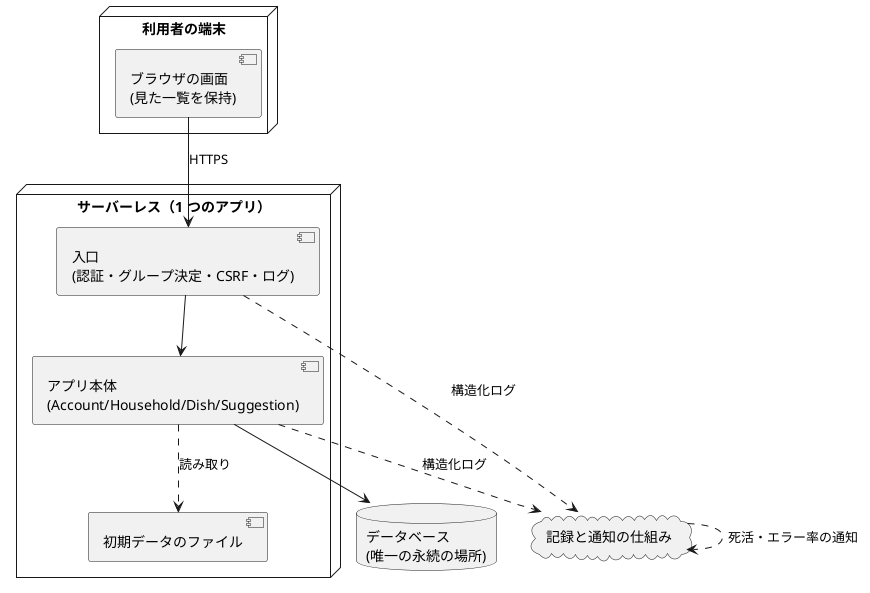

# 論理コンポーネント：U1 最小の通し版

動かす部品の見取り図です。どこで何が動き、壊れたらどこまで影響するかを示します。具体的なサービス名や設定は、Infrastructure Design で決めます。

## 根拠（Sources）

- [Q1〜Q5] NFR Design の回答（すべて A）
- [scope] `tech-stack-decisions.md`、`components.md`（Account、Household、Dish、Suggestion）、`contract-summary.md`

## 部品の一覧

| 部品 | 役割 | 状態を持つか | 影響の範囲 |
|---|---|---|---|
| ブラウザの画面 | 画面の表示、スワイプ、「見た一覧」の保持 | 持つ（見た一覧のみ、画面を閉じると消える） | 利用者 1 人 |
| 入口（リクエストの共通処理） | HTTPS の確認、Cookie からの本人確認、グループの決定、合言葉と送り元の確認、リクエストの識別子の発行、ログ | 持たない | 全利用者 |
| アプリ本体（1 つの関数） | アカウント、家族グループ、料理、候補と「選んだもの」の業務処理。出来事の受け口（初期データの登録） | 持たない | 全利用者 |
| データベース | アカウント、ログイン状態、グループ、メンバー、料理、材料、「選んだもの」 | 持つ（唯一の永続の場所） | 全利用者。壊れるとデータが失われる（RISK-1） |
| 初期データのファイル | 30 件の料理の雛形 | 読み取りのみ（アプリと一緒に配る） | 新しいグループ |
| 死活の確認の入口 | 動いているかの確認（データベースに触れない。30 分ごと）。データベース接続の確認は別の入口で、人が呼ぶ | 持たない | 通知のみ |
| 記録と通知の仕組み | ログの保管、死活とエラー率の通知 | 持つ（ログ、30 日） | 運用者 |

## 構成図

## 失敗したときの影響

| 失敗 | 影響 | 備え |
|---|---|---|
| アプリ本体が落ちる | 全機能が止まる | 自動で再起動（サーバーレス）、死活の通知 |
| データベースが落ちる | 全機能が止まる | 死活の通知。復旧は人が行う |
| データベースが壊れる | **データが失われる**（バックアップなし、RISK-1） | 受け入れた（F1 B） |
| 初期データの登録が失敗する | 初期データが入らない | ホームを開いたときに補う（NFR4.8）、「準備中」の表示 |
| 記録と通知の仕組みが落ちる | ログと通知が止まる。機能は動く | なし（通し版） |
| 外部の動画・投稿のサイトが落ちる | 元の動画が開けない。機能は動く | なし |

## 共有の資源

- データベースだけが共有の資源。ユニット（U2〜U7）は同じデータベースを使うが、コンポーネントごとに自分の表を持つ（ADR-009）。
- 出来事の受け渡しは、1 つのアプリの内側で行う（別のサーバーへの通信はない）。

## Assumptions & Open Questions

- [assumption] 出来事は、アプリ本体の内側の呼び出しとして実装する（at-least-once の性質は、取引の外で呼ぶことと、冪等な受け手で表す）。
- OQ1 出来事を別の仕組み（キュー等）にするかは、U7 のグループ削除の連鎖が必要になったときに、Infrastructure Design で見直す。
