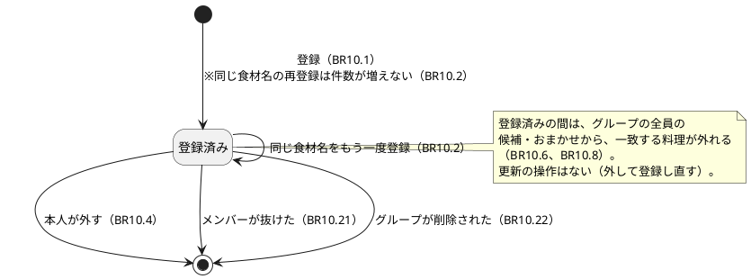
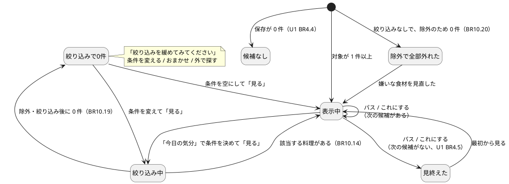
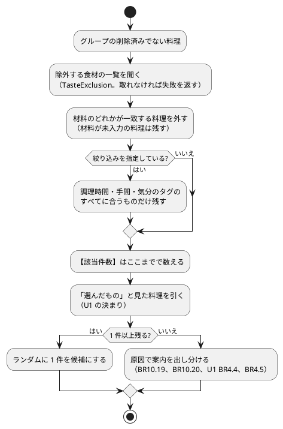
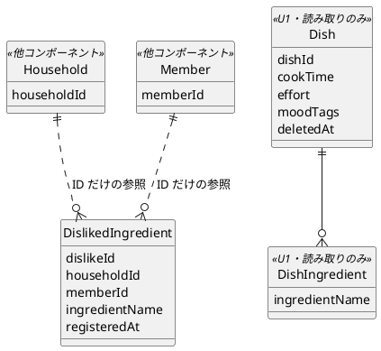

# 機能仕様：U2 好き嫌いと絞り込み

操作の流れ（ワークフロー）と、状態の移り変わり（状態遷移）の正（source of truth）です。データの形は `entities.md`、判断のルールは `rules.md` が正で、この文書の ER 図とルール一覧は、そこから作った読みやすい版です。技術は決めません。

## 範囲

U2 は、U1 の「買い物前の候補」に、**家族の嫌いな食材による除外**と、**「今日の気分」での絞り込み**を足すユニットです。含むのは、嫌いな食材の登録・削除、除外の判定、材料が未入力の料理の表示、絞り込み（調理時間・手間・気分のタグ）、「おまかせ」、「外で探す」、絞り込みで 0 件のときの案内です。含まないのは、アレルギー（FR13、Won't）、食材名の正規化（Won't）、献立での除外の利用（U4）、「もう作りたくない」の並べ替え（U5）、メンバーが抜ける操作そのもの（U7。U2 は出来事を受けるだけ）です。

## 用語（日本語 / 英語）

| 日本語 | 英語 | 意味 |
|---|---|---|
| ワークフロー | Workflow | 1 つの目的のために、順に行う操作の流れ |
| 状態遷移 | State transition | 「登録済み → 削除済み」のような、状態の移り変わり |
| 除外 | Exclusion | 嫌いな食材を含む料理を、候補から外すこと |
| 絞り込み | Filter | 調理時間・手間・気分のタグで、候補を狭めること |
| 部分一致 | Partial match | 材料名の中に、登録した文字列が含まれていれば一致とみなすこと |
| 冪等 | Idempotent | 同じ操作を繰り返しても、結果が同じになること |

## ワークフロー

### WF1. 嫌いな食材を登録する（US4.1、US4.3）

1. 利用者が「好き嫌い」の画面を開く。自分の登録だけが、古い順に並ぶ（BR10.5）。「アレルギーを防ぐものではありません」の注意が出る（BR10.24）。
2. 食材名を入力して登録する。「材料に書かれた文字のとおり入力」の案内が出る（BR10.24）。
3. システムが、前後の空白を除き、1〜50 文字を確認する（BR10.1）。違反なら、入力を残したままエラーを出す。
4. 自分の登録がすでに 50 件なら、登録せずに知らせる（BR10.3）。
5. 同じ食材名が自分の登録にすでにあれば、何もせず成功を返す（BR10.2）。なければ、DislikedIngredient を作る（memberId・householdId はログイン状態から決める。BR10.1、BR10.23）。
6. 次に候補を見るとき、家族の誰の候補にも、この食材を含む料理が出なくなる（BR10.6、BR10.8）。

エラーの流れ：未ログインは拒否（BR10.23）。同時に同じ登録が来ても 1 件（BR10.2）。

### WF2. 嫌いな食材を外す（US4.1）

1. 利用者が、自分の登録の一覧から、1 件を選んで外す。
2. 自分の登録でない、または他のグループの dislikeId は「見つからない」（BR10.4）。
3. 外すと、次の候補の取得から、その食材は除外の対象でなくなる。繰り返しても結果は同じ（BR10.4）。

### WF3. 「今日の気分」で絞り込んで候補を見る（US2.2、US2.3、US2.4）

1. 利用者が「買い物前」で「今日の気分」のシートを開く。調理時間・手間・気分のタグの選択肢が、横にスクロールせずにすべて見える（BR10.10、BR10.15）。
2. 条件を選ぶたびに、いまの条件に合う料理の件数が出る（BR10.13）。何も選ばなければ、保存した全項目（除外後）が対象（BR10.12）。
3. 「見る」を押す。画面は、見た料理の一覧を空にして、条件つきで候補を要求する（BR10.14）。
4. サーバーが、次の順で候補を作る（BR10.25、BR10.8、BR10.11）。
   1. 候補の提案（Suggestion）が、窓口 TasteExclusion で、除外する食材の一覧を好き嫌い（Taste）に聞く（グループの全員分。BR10.6）。取れなければ、候補を出さずに失敗を返す（BR10.25）。
   2. グループの削除済みでない料理から、材料のどれかが除外する食材に一致するものを外す（BR10.7、BR10.8）。材料が未入力の料理は外さない（BR10.9）。
   3. 絞り込みを指定していれば、BR10.11 に合うものだけを残す。
   4. この時点の件数を、「該当件数」とする。0 件なら手順 6 へ。
   5. U1 のとおり、「選んだもの」と見た料理を引き、ランダムに 1 件を選ぶ（U1 BR4.1、BR4.3）。
5. 候補をカードで返す。材料が未入力なら「材料が未入力」を添える（BR10.9）。「これにする」「パス」の操作は U1 のとおり（U1 WF5）。
6. 0 件のときの案内を、原因で出し分ける（BR10.19、BR10.20）。
   - 絞り込みを指定していて、除外と絞り込み後に 0 件 → 「絞り込みを緩めてみてください」と、「条件を変える」「おまかせ」「外で探す」。
   - 絞り込みなしで、除外のせいで 0 件 → 「登録された嫌いな食材で、候補がすべて外れています」と、好き嫌いの画面への入口。
   - 保存が 0 件 → U1 の案内（U1 BR4.4）。
   - 該当はあるが、すべて見た・選んだ → 「見終えました」と「最初から見る」（U1 BR4.5）。
7. 条件を変えて「見る」を押すと、手順 3 に戻る。条件を空にして「見る」を押すと、絞り込みなしの候補に戻る。

### WF4. 「おまかせ」で 1 件出す（US2.5）

1. 利用者が「おまかせ」を押す。
2. サーバーが、除外する食材の一覧を聞き（BR10.25）、グループの削除済みでない料理から、除外に一致するものを外す（BR10.8）。絞り込みの条件・見た料理・「選んだもの」は使わない（BR10.16）。
3. 残りからランダムに 1 件を返す。0 件なら、BR10.20 の案内（保存が 0 件なら U1 の案内）。
4. 出た料理に、「これにする」「パス」ができる（U1 BR4.6）。

### WF5. 「外で探す」（US2.5）

1. 利用者が、「今日の気分」で選んでいる条件のまま、「外で探す」を押す。
2. 画面が、検索語を作る：選んでいる気分のタグ、調理時間の言葉、「レシピ」を空白で並べる。何も選んでいなければ「レシピ」だけ（BR10.17）。
3. 利用者の端末が、YouTube の検索画面を新しいタブで開く。このアプリは、検索結果を取り込まない（BR10.18）。

### WF6. 出来事を受けて、好き嫌いを整える（US7.3、US7.5 の受け側）

1. 「メンバーが抜けた」（household.member-left）を受ける：そのメンバーの DislikedIngredient をすべて消す（BR10.21）。
2. 「グループが削除された」（household.deleted）を受ける：そのグループの DislikedIngredient をすべて消す（BR10.22）。暫定の案。
3. どちらも、同じ出来事を二度受けても結果は同じ。順序にも依存しない。対象がなくても成功（ADR-007）。

## 状態遷移

### ST1. DislikedIngredient（嫌いな食材）

### ST2. 候補を見る流れ（画面側の状態。U1 の ST4 を拡張）

### ST3. 除外・絞り込みの判定の順序

## ER 図（entities.md から作った読み取り用の図）

## ルールの概要（rules.md から作った読み取り用の一覧）

| グループ | 内容 | ルール |
|---|---|---|
| 登録・削除 | 1〜50 文字、二重登録なし、50 件まで、削除は本人だけ、自分の分だけ表示 | BR10.1〜BR10.5 |
| 除外の判定 | グループ全員の一覧、部分一致、候補・おまかせ・件数に適用、材料未入力は出して明示 | BR10.6〜BR10.9 |
| 絞り込み | 3 種類の条件、30 分以内は累積、タグは OR、条件間は AND、件数表示、画面が条件を持つ | BR10.10〜BR10.15 |
| おまかせ・外で探す | 除外だけ適用、YouTube 検索画面を開くだけ | BR10.16〜BR10.18 |
| 0 件の案内 | 絞り込みで 0 件、除外で全部外れた | BR10.19〜BR10.20 |
| 出来事・入口・拡張点 | 抜けた・削除の受け口、グループの範囲、アレルギーではない表示、除外一覧が取れなければ出さない | BR10.21〜BR10.25 |

## 他のユニットとの境界

| 相手 | U2 での扱い |
|---|---|
| U1（最小の通し版） | U1 の候補の取得（nextCandidate 相当）に、除外と絞り込みを足す。U1 には TasteExclusion の窓口も既定の実装もない。U2 の作業として、窓口の新設と既定の実装（空の除外）、nextCandidate への絞り込み条件・除外の追加、該当件数とおまかせの入口を足す（BR10.25）。「選んだもの」「見た料理」の扱いは変えない |
| U3（買い物リスト） | U2 は関与しない。選んだものは除外で消さない（BR10.8）ので、U3 は変わらない |
| U4（献立） | 献立の除外は、候補の提案の判定（SuggestionJudge）を通して、U2 と同じ除外を使う。U4 の機能設計で扱う（AC4.1.2 の「献立」の部分） |
| U5（作った記録） | 「もう作りたくない」の並べ替えは U5 が足す。U2 の除外と絞り込みの後に、並び順を決める |
| U7（管理） | 出来事 household.member-left、household.deleted を出すのは U7。受け口は U2（WF6） |

## 根拠（Sources）

- [Q1〜Q6] `functional-design-questions.md` の回答（すべて A）
- [scope] `unit-of-work.md`、`unit-of-work-story-map.md`（U2 の担当ストーリー）
- [contract] `contract-summary.md`（C1 の窓口、C2 の TasteExclusion、C3 の出来事）
- [memory] ADR-002（除外・並び順の判定は候補の提案が持つ）、ADR-004、ADR-005、ADR-007、ADR-009
- [U1] U1 の `rules.md`、`functional-spec.md`

## Assumptions & Open Questions

- [assumption] 部分一致（Q1 A）は、短い食材名で意図しない料理も外す（たとえば「ねぎ」で「長ねぎ」も外れる。これは意図どおり）。逆に、1 文字の登録（たとえば「卵」）は広く一致する。1 文字の登録を禁じる規則は置かない（利用者が見直せる。BR10.20 の案内がある）。
- [assumption] 「選んだもの」に入っている料理は、除外が後から増えても外さない（BR10.8）。選んだものを買い物リストにしたとき、食べられない食材が含まれうる。気づけるようにするかは、U3 の機能設計で検討する。
- [assumption] U1 の出来事はアプリ内の呼び出しで、再送も eventId もない。抜けた人の登録が消えずに残っても、除外一覧は現在のメンバーの登録だけから作る（BR10.6）ので、除外は過剰にならない。
- [assumption] 調理時間は over30／cookTime を正とする。契約 C1・C2 の longer／cookTimeBand、および件数・気分のタグの選択肢の窓口は、U2 のコード生成のときに contract-summary を直し、足す。
- [assumption] 絞り込みの条件は、端末ごとに画面が持つ。端末をまたいで共有しない（U1 の「見た料理の一覧」と同じ）。
- OQ1（解消済み）出来事が届かなかったときの手当ては、除外一覧を現在のメンバー（退会していない人）の登録だけから作る（BR10.6）と決めた。
- OQ2 気分のタグが多数になったときの見せ方（折り返しのままか、よく使うものを先に出すか）は、UI の実装で決める。最初の版は折り返して全部見せる（BR10.15）。
