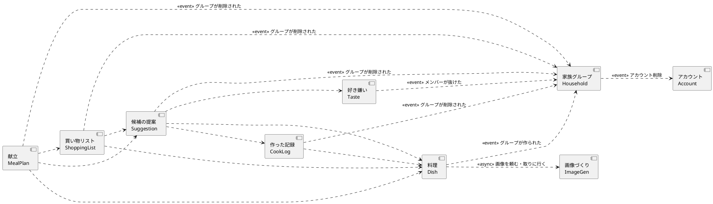

# コンポーネント一覧（ドメイン設計）

自分たちで書くコードの単位である「コンポーネント」を、9 つに分けた。決めた根拠は `decisions.md`（ADR）にある。デプロイのまとめ方（モノリスにするか、分けるか）は、ここでは決めない（次の Units Generation で決める）。

## Sources

- [Q1]〜[Q6] `domain-design-questions.md` の回答：Q1 A、Q2 A、Q3 A、Q4 B、Q5 A、Q6 A
- [US] `stories.md` のユーザーストーリー（US1.1〜US9.1）
- [FR] `requirements.md` の機能要件・非機能要件
- [memory:M1] チームの実践（`team.md`）

## Assumptions & Open Questions

- [assumption] Q1 は A（8 つに分ける）だったが、Q4 が B（好き嫌いを独立したコンポーネント「好き嫌い」にする）だったため、合計は 9 つになった。
- [assumption] お気に入りは、グループで共有する項目の印として、料理（Dish）が持つ。メンバーごとのお気に入りが必要になった場合は、見直す。
- [assumption] グループの所属の確認（このリクエストの送り主は、このグループのメンバーか）は、リクエストの入口にある共通の仕組み（アカウントと家族グループの窓口を使う部分。コンポーネントではない）でまとめて行う（ADR-005）。コンポーネントの間の呼び出しでも、出来事でも、確認済みの householdId を必ず渡し、受け側は householdId で絞る。
- [assumption] 他のコンポーネントのエンティティを指す参照は、ID だけを値として持つ。ID だけの参照は、依存（矢印）にしない。矢印になるのは、実際に呼び出す・出来事を受ける関係だけである（ADR-009）。そのため、`references` に Member が現れても、CookLog・Suggestion・Dish から家族グループへの矢印はない。
- [assumption] パスした項目は、閲覧中だけの状態として画面側に持ち、コンポーネントのデータとしては保存しない。
- OQ1 生成 AI の画像（FR1.7、FR12.6）：使うサービス、作るタイミング、費用の上限、著作権・安全面は、要件の OQ7 のまま未決定。画像づくり（ImageGen）の中に閉じ込めたので、決まってから設計できる。
- [decided] アカウント削除後も記録と項目は残り、名前は表示しない（FR7.5）：メンバーの行は残して「退会した印」（leftAt）を付け、名前を消す。他のコンポーネントが持つ memberId は、ID だけの値で、「退会したメンバー」と表示する（ADR-009）。
- [decided] グループの削除は「試してみたい機能」であり、このステージでは深く議論しない。ここに書いた連鎖（出来事で全データを消す）は暫定の案で、1st バージョンを触ってから見直す（利用者の指示）。
- [decided] グループの削除（最後の 1 人が抜けたとき、FR7.6）：家族グループが「グループが削除された」出来事を知らせ、料理、好き嫌い、作った記録、候補の提案、献立、買い物リストが、それぞれ自分のデータを消す。画像づくりは、料理が項目を消すときに削除を頼まれて消す（ADR-007、ADR-008）。
- [decided] 項目の削除は論理削除（ADR-008）。
- OQ2 出来事が届かないときの扱い（再送、後から整える）と、出来事の伝え方は、Contract Design で決める。ADR-007 の前提（少なくとも 1 回届く、受け側は二度受けても結果が同じ）は、このステージで決めた。
- OQ3 候補の提案が、料理・好き嫌い・作った記録へ問い合わせる処理は、一括で聞く形にすることが、Contract Design の必須条件（性能の目標が決まっていないため）。

## コンポーネントのカタログ（機械が読む部分）

```yaml
components:
  - name: Account
    summary: アカウント（登録、ログイン、パスワード再設定、ログイン失敗の制限）を持つ
    behaviour: >
      メールアドレスとパスワードでアカウントを作る。パスワードは暗号化して保存し、平文では持たない。
      ログインに 5 回続けて失敗したら、15 分間そのアカウントのログインを止める。
      パスワードを忘れたときは、再設定の案内メールを送る。アカウントを削除したら、「アカウントを削除した」という出来事を知らせる。
    responsibilities:
      - アカウントの作成、ログイン、ログアウト
      - パスワードの再設定
      - ログイン失敗の制限
      - アカウントの削除と、その出来事の通知
    depends_on: []
    dependents:
      - component: Household
        interaction: アカウント削除の出来事を受けて、メンバーを外す
    external_dependencies:
      - name: メール送信サービス
        kind: third-party-api
        purpose: パスワード再設定の案内メールを送る
      - name: データベース
        kind: database
        purpose: アカウントを保存する
    entities:
      - name: Account
        identifier: accountId
        attributes: [email, passwordHash, failedLoginCount, lockedUntil]
        references: []

  - name: Household
    summary: 家族グループ、メンバー、招待を持つ
    behaviour: >
      グループを作ると、「グループが作られた」という出来事を知らせる。
      招待リンクは 7 日間有効で、期限が切れたら無効にする。リンクを開いた人を、メンバーに加える。
      メンバーが抜ける、またはアカウントが削除されたら、メンバーを外し（行は残し、退会した印 leftAt を付け、名前を消す。ADR-009）、
      「メンバーが抜けた」という出来事を知らせる。
      最後の 1 人が抜けたら、グループを削除し、「グループが削除された」という出来事を知らせる（受け手は、このグループの全データを消す）。
    responsibilities:
      - グループの作成
      - 招待リンクの発行と、期限切れの扱い
      - メンバーの追加と、脱退
      - グループの削除
    depends_on:
      - component: Account
        interaction: アカウント削除の出来事を受けて、メンバーを外す
        style: event
    dependents:
      - component: Taste
        interaction: メンバーが抜けた出来事を受けて、その人の好き嫌いを外す。グループが削除された出来事を受けて、そのグループの好き嫌いをすべて消す
      - component: Dish
        interaction: グループが作られた出来事を受けて、初期データ 30 件を登録する。グループが削除された出来事を受けて、そのグループの項目をすべて消す
      - component: CookLog
        interaction: グループが削除された出来事を受けて、そのグループの記録をすべて消す
      - component: Suggestion
        interaction: グループが削除された出来事を受けて、そのグループの「選んだもの」をすべて消す
      - component: MealPlan
        interaction: グループが削除された出来事を受けて、そのグループの献立をすべて消す
      - component: ShoppingList
        interaction: グループが削除された出来事を受けて、そのグループの買い物リストをすべて消す
    external_dependencies:
      - name: データベース
        kind: database
        purpose: グループ、メンバー、招待を保存する
    entities:
      - name: Household
        identifier: householdId
        attributes: [name, createdAt]
        references: []
      - name: Member
        identifier: memberId
        attributes: [householdId, accountId, displayName, joinedAt, leftAt]
        references:
          - entity: Account
            owned_by: Account
            relationship: 各メンバーは、1 つのアカウントに対応する
          - entity: Household
            owned_by: Household
            relationship: 各メンバーは、1 つのグループに所属する
      - name: Invitation
        identifier: invitationId
        attributes: [householdId, token, expiresAt, usedAt]
        references:
          - entity: Household
            owned_by: Household
            relationship: 各招待は、1 つのグループへの招待である

  - name: Taste
    summary: メンバーごとの嫌いな食材（好き嫌い）を持つ
    behaviour: >
      メンバーが嫌いな食材を登録・削除する。食材名は、文字列の一致だけで判定する（表記ゆれの正規化はしない）。
      「このグループが除外する食材の一覧」を答える。メンバーが抜けた出来事を受けたら、その人の好き嫌いを外す。
      アレルギーは、最初の実装では扱わない。
    responsibilities:
      - 嫌いな食材の登録と削除
      - グループの除外一覧の回答
      - 抜けたメンバーの好き嫌いの削除
    depends_on:
      - component: Household
        interaction: メンバーが抜けた出来事、グループが削除された出来事を受ける
        style: event
    dependents:
      - component: Suggestion
        interaction: 候補・献立から外す食材を聞く
    external_dependencies:
      - name: データベース
        kind: database
        purpose: 嫌いな食材を保存する
    entities:
      - name: DislikedIngredient
        identifier: dislikeId
        attributes: [householdId, memberId, ingredientName, registeredAt]
        references:
          - entity: Member
            owned_by: Household
            relationship: 各登録は、1 人のメンバーによるもの

  - name: Dish
    summary: 保存した項目（料理）、材料、お気に入り、登録した画像を持つ
    behaviour: >
      URL と料理名で項目を保存する。URL は http または https のみ受け付ける。
      条件（調理時間、手間、気分のタグ、食材の種類）、材料と分量、メモ、画像を足せる。
      グループが作られた出来事を受けて、初期データ 30 件（ダミーの URL と AI の画像つき）を登録する。
      初期データはデータファイルから読み、開発時にプログラムを変えずに入れ替えられる。
      画像がない項目は、画像づくりに依頼し、できた画像は Dish の側から取りに行く（ImageGen から Dish への呼び出しはない）。
      項目を利用者が削除したときは、論理削除（削除済みの印を付け、候補・献立からは外すが、記録・買い物リスト・過去の献立には残す。ADR-008）。
      グループが削除されたときだけ、そのグループの項目をすべて物理的に消す。他のグループの項目は見せない。
    responsibilities:
      - 項目の保存、編集、削除
      - 材料と分量の管理
      - お気に入りの付け外し
      - 初期データの登録
      - 利用者が登録した画像の保管
      - 画像がない項目の、画像づくりの依頼
    depends_on:
      - component: Household
        interaction: グループが作られた出来事を受けて初期データを登録し、グループが削除された出来事を受けて項目を消す
        style: event
      - component: ImageGen
        interaction: 画像がない項目の画像を頼み、できた画像を取りに行く（Dish から ImageGen への一方向）。グループの項目を消すときは、画像の削除を頼む
        style: async
    dependents:
      - component: CookLog
        interaction: どの料理かを確かめる
      - component: Suggestion
        interaction: 候補の元になる項目を取る
      - component: MealPlan
        interaction: 献立に使う料理を取る
      - component: ShoppingList
        interaction: 材料と分量を取る
    external_dependencies:
      - name: データベース
        kind: database
        purpose: 項目、材料、画像を保存する
    entities:
      - name: Dish
        identifier: dishId
        attributes: [householdId, name, url, cookTimeBand, effort, moodTags, ingredientKind, memo, isSample, isFavorite, isDeleted, createdBy, createdAt]
        references:
          - entity: Household
            owned_by: Household
            relationship: 各項目は、1 つのグループのもの（ID だけを値として持つ。ADR-009）
          - entity: Member
            owned_by: Household
            relationship: 各項目は、保存したメンバーに結び付く（createdBy。ID だけを値として持つ。ADR-009）
      - name: Ingredient
        identifier: ingredientId
        attributes: [dishId, name, quantity, unit]
        references:
          - entity: Dish
            owned_by: Dish
            relationship: 各材料は、1 つの項目のもの
      - name: RegisteredImage
        identifier: registeredImageId
        attributes: [dishId, fileRef, byteSize, registeredAt]
        references:
          - entity: Dish
            owned_by: Dish
            relationship: 各登録画像は、1 つの項目のもの

  - name: ImageGen
    summary: 登録画像がない項目の、AI の画像を作って持つ
    behaviour: >
      画像づくりの依頼を受けたら、生成 AI で画像を作り、保管する。
      できるまでの間は「作成中」とし、画面は色の枠を出す。作った画像には、「AI が作ったイメージ」の印を付ける。
      できた画像は、料理の側が取りに行く（結果を料理へ返す呼び出しはしない。ADR-009）。料理から削除を頼まれたら、その項目の画像を消す。
      生成 AI のサービスは、このコンポーネントの中に閉じ込め、他のコンポーネントは知らない。
    responsibilities:
      - 生成 AI を呼んで画像を作る
      - 作った画像の保管と、作成状態の管理
      - 失敗時の再試行と、費用・回数の上限の管理（OQ1）
    depends_on: []
    dependents:
      - component: Dish
        interaction: 画像づくりと画像の削除を頼まれ、できた画像を取りに来られる
    external_dependencies:
      - name: 生成 AI サービス
        kind: third-party-api
        purpose: 料理のイメージ画像を作る
      - name: データベース
        kind: database
        purpose: 作った画像の記録を保存する
      - name: 画像の置き場
        kind: object-store
        purpose: 作った画像のファイルを保管する
    entities:
      - name: GeneratedImage
        identifier: generatedImageId
        attributes: [dishId, fileRef, status, generatedAt]
        references:
          - entity: Dish
            owned_by: Dish
            relationship: 各 AI の画像は、1 つの項目のもの

  - name: CookLog
    summary: 項目と「作った日」の 1 対多の記録を持つ
    behaviour: >
      1 つの項目に、作った日の記録を何件でも追加できる。1 件は、作った日、感想（任意）、注意点メモ（任意）を持つ。
      作った日は今日までで、未来は断る。同じ日に同じ項目の二重登録を断る。記録の編集・削除ができる。
      月ごとに、カレンダー用にまとめて答える。項目ごとの最新の感想を答える。
    responsibilities:
      - 作った日の記録の追加、編集、削除
      - 二重登録と未来の日付の防止
      - カレンダー用の月ごとの集計
      - 項目ごとの最新の感想の回答
    depends_on:
      - component: Dish
        interaction: 記録する項目が存在するかを確かめる（追加時のみ。削除済みの項目の記録は残る）
        style: sync
      - component: Household
        interaction: グループが削除された出来事を受けて、そのグループの記録をすべて消す
        style: event
    dependents:
      - component: Suggestion
        interaction: 項目ごとの最新の感想を聞く
    external_dependencies:
      - name: データベース
        kind: database
        purpose: 作った日の記録を保存する
    entities:
      - name: CookRecord
        identifier: recordId
        attributes: [householdId, dishId, memberId, cookedOn, impression, cautionMemo, createdAt]
        references:
          - entity: Dish
            owned_by: Dish
            relationship: 各記録は、1 つの項目の記録で、1 つの項目に何件もある
          - entity: Member
            owned_by: Household
            relationship: 各記録は、記録したメンバーに結び付く

  - name: Suggestion
    summary: 買い物前の候補の提案と、「選んだもの」を持つ
    behaviour: >
      保存した項目から、候補を 1 件ずつ出す。「今日の気分」（調理時間、手間、気分のタグ）で絞り込む。
      家族の誰かが除外した食材を含む項目は外す（材料が未入力の項目は、未入力と明示して出す）。
      並び順を決める：最新の感想が「もう作りたくない」の項目を後ろにずらす。
      「おまかせ」で 1 件をランダムに出す。「外で探す」のためのキーワードを作る。
      「これにする」で「選んだもの」に入れ、外すこともできる。
      除外・並び順の判定は、献立の提案からも使われる（ここに 1 か所にまとめる）。
    responsibilities:
      - 候補の絞り込み、除外、並び順の判定
      - 「おまかせ」と、外で探すキーワードの作成
      - 「選んだもの」の管理
    depends_on:
      - component: Dish
        interaction: 候補の元になる項目を取る
        style: sync
      - component: Taste
        interaction: 外す食材の一覧を聞く
        style: sync
      - component: CookLog
        interaction: 項目ごとの最新の感想を聞く（項目の一覧をまとめて渡して一括で聞く）
        style: sync
      - component: Household
        interaction: グループが削除された出来事を受けて、そのグループの「選んだもの」をすべて消す
        style: event
    dependents:
      - component: MealPlan
        interaction: 除外・並び順の判定を使う
      - component: ShoppingList
        interaction: 選んだものを取る
    external_dependencies:
      - name: データベース
        kind: database
        purpose: 選んだものを保存する
    entities:
      - name: PickedItem
        identifier: pickedId
        attributes: [householdId, dishId, memberId, pickedAt]
        references:
          - entity: Dish
            owned_by: Dish
            relationship: 各「選んだもの」は、1 つの項目を指す
          - entity: Member
            owned_by: Household
            relationship: 各「選んだもの」は、選んだメンバーに結び付く

  - name: MealPlan
    summary: 1 週間の献立と、保存した献立を持つ
    behaviour: >
      1 週間（7 日分）の献立を提案する。同じ料理は 1 週間に 2 回まで、同じ食材の種類は 3 日続けない。
      日ごと・週全体をやり直せる。日ごとに「この日は作らない」を設定・解除できる（作らない日は提案と買い物リストの対象外）。
      「選んだもの」を日に割り当てる。献立を保存して、あとで呼び出せる。
      除外・並び順の判定は、候補の提案の判定を使う。
    responsibilities:
      - 1 週間の献立の提案
      - やり直しと、作らない日の設定・解除
      - 選んだものの割り当て
      - 献立の保存と呼び出し
    depends_on:
      - component: Suggestion
        interaction: 除外・並び順の判定を使う
        style: sync
      - component: Dish
        interaction: 献立に使う料理を取る
        style: sync
      - component: ShoppingList
        interaction: この献立の材料を渡して、買い物リストにまとめてもらう（向きは、ユニットの依存 U4 → U3 に合わせた。ADR-010）
        style: sync
      - component: Household
        interaction: グループが削除された出来事を受けて、そのグループの献立をすべて消す
        style: event
    dependents: []
    external_dependencies:
      - name: データベース
        kind: database
        purpose: 献立を保存する
    entities:
      - name: MealPlan
        identifier: planId
        attributes: [householdId, startDate, isSaved, name, createdAt]
        references: []
      - name: PlanDay
        identifier: planDayId
        attributes: [planId, date, isSkipDay, dishId]
        references:
          - entity: MealPlan
            owned_by: MealPlan
            relationship: 各日は、1 つの献立のもの
          - entity: Dish
            owned_by: Dish
            relationship: 各日は、0 件または 1 件の項目を指す

  - name: ShoppingList
    summary: 買い物リスト（材料の集計とチェック）を持つ
    behaviour: >
      選んだもの、または献立の材料から、買い物リストを作る。同じ材料で単位も同じものは合算し、単位が違うものは別の行にする。
      材料が未入力の項目には「材料の入力が必要」と知らせる。作らない日の料理は含めない。
      買ったものにチェックを付け外しでき、チェックは保存される。
    responsibilities:
      - 材料の集計
      - 材料が未入力の項目の通知
      - チェックの付け外しと保存
    depends_on:
      - component: Suggestion
        interaction: 選んだものを取る
        style: sync
      - component: Dish
        interaction: 材料と分量を取る
        style: sync
      - component: Household
        interaction: グループが削除された出来事を受けて、そのグループの買い物リストをすべて消す
        style: event
    dependents:
      - component: MealPlan
        interaction: 献立の材料を渡されて、買い物リストにまとめる
    external_dependencies:
      - name: データベース
        kind: database
        purpose: 買い物リストとチェックを保存する
    entities:
      - name: ShoppingList
        identifier: listId
        attributes: [householdId, createdAt]
        references: []
      - name: ShoppingItem
        identifier: itemId
        attributes: [listId, ingredientName, quantity, unit, checked, sourceDishId]
        references:
          - entity: ShoppingList
            owned_by: ShoppingList
            relationship: 各行は、1 つの買い物リストのもの
          - entity: Dish
            owned_by: Dish
            relationship: 各行は、材料の元の項目を指す
```

## コンポーネント図

PlantUML のコードは `component-diagram.puml` にある（UML のコンポーネント図）。ここに、要約を載せる。



## コンポーネントの要約

| コンポーネント | 目的 | 頼る先 | 頼られる先 | 持つエンティティ |
|---|---|---|---|---|
| アカウント（Account） | ログイン情報を持つ | なし | 家族グループ | Account |
| 家族グループ（Household） | グループ、メンバー、招待を持つ | アカウント（出来事） | 好き嫌い、料理、作った記録、候補の提案、献立、買い物リスト（すべて出来事） | Household、Member、Invitation |
| 好き嫌い（Taste） | 嫌いな食材を持つ | 家族グループ（出来事） | 候補の提案 | DislikedIngredient |
| 料理（Dish） | 項目、材料、画像を持つ | 家族グループ（出来事）、画像づくり（非同期。結果は取りに行く） | 作った記録、候補の提案、献立、買い物リスト | Dish、Ingredient、RegisteredImage |
| 画像づくり（ImageGen） | AI の画像を作って持つ | なし | 料理 | GeneratedImage |
| 作った記録（CookLog） | 項目と作った日の 1 対多の記録を持つ | 料理、家族グループ（出来事） | 候補の提案 | CookRecord |
| 候補の提案（Suggestion） | 候補の判定と選んだものを持つ | 料理、好き嫌い、作った記録、家族グループ（出来事） | 献立、買い物リスト | PickedItem |
| 献立（MealPlan） | 1 週間の献立を持つ | 候補の提案、料理、買い物リスト（材料を渡す）、家族グループ（出来事） | なし | MealPlan、PlanDay |
| 買い物リスト（ShoppingList） | 買い物リストとチェックを持つ | 候補の提案、料理、家族グループ（出来事） | 献立 | ShoppingList、ShoppingItem |

## エンティティの持ち主

エンティティはすべて、ちょうど 1 つのコンポーネントが持つ。データ型・制約・関係の数は、Functional Design（`entities.md`）で決める。

| エンティティ | 持ち主 | 識別子 | 属性 | 他への参照 |
|---|---|---|---|---|
| Account | Account | accountId | email、passwordHash、failedLoginCount、lockedUntil | なし |
| Household | Household | householdId | name、createdAt | なし |
| Member | Household | memberId | householdId、accountId、displayName、joinedAt、leftAt | Account、Household |
| Invitation | Household | invitationId | householdId、token、expiresAt、usedAt | Household |
| DislikedIngredient | Taste | dislikeId | householdId、memberId、ingredientName、registeredAt | Member |
| Dish | Dish | dishId | householdId、name、url、cookTimeBand、effort、moodTags、ingredientKind、memo、isSample、isFavorite、isDeleted、createdBy、createdAt | Household、Member |
| Ingredient | Dish | ingredientId | dishId、name、quantity、unit | Dish |
| RegisteredImage | Dish | registeredImageId | dishId、fileRef、byteSize、registeredAt | Dish |
| GeneratedImage | ImageGen | generatedImageId | dishId、fileRef、status、generatedAt | Dish |
| CookRecord | CookLog | recordId | householdId、dishId、memberId、cookedOn、impression、cautionMemo、createdAt | Dish、Member |
| PickedItem | Suggestion | pickedId | householdId、dishId、memberId、pickedAt | Dish、Member |
| MealPlan | MealPlan | planId | householdId、startDate、isSaved、name、createdAt | なし |
| PlanDay | MealPlan | planDayId | planId、date、isSkipDay、dishId | MealPlan、Dish |
| ShoppingList | ShoppingList | listId | householdId、createdAt | なし |
| ShoppingItem | ShoppingList | itemId | listId、ingredientName、quantity、unit、checked、sourceDishId | ShoppingList、Dish |

## 外部の依存

| コンポーネント | 依存するもの | 種類 | 目的 |
|---|---|---|---|
| Account | メール送信サービス | third-party-api | パスワード再設定のメールを送る |
| Account | データベース | database | アカウントを保存する |
| Household | データベース | database | グループ、メンバー、招待を保存する |
| Taste | データベース | database | 嫌いな食材を保存する |
| Dish | データベース | database | 項目、材料、画像を保存する |
| ImageGen | 生成 AI サービス | third-party-api | 料理のイメージ画像を作る |
| ImageGen | データベース、画像の置き場 | database、object-store | 作った画像の記録とファイルを保存する |
| CookLog | データベース | database | 作った日の記録を保存する |
| Suggestion | データベース | database | 選んだものを保存する |
| MealPlan | データベース | database | 献立を保存する |
| ShoppingList | データベース | database | 買い物リストとチェックを保存する |

## 根拠（Rationale）

| コンポーネント | 別のコンポーネントにする理由 |
|---|---|
| アカウント | ログイン情報は、家族の中身とは別の寿命・別の扱い（暗号化、ロック）を持つ |
| 家族グループ | グループとメンバーの出入りは、料理や記録とは別の変更理由で変わる |
| 好き嫌い | 除外の判定は、アレルギーなどで拡張される見込みがあり、メンバーの出入りとは別の変更理由で変わる（ADR-004） |
| 料理 | 項目と材料は、候補・献立・買い物・記録のすべてが参照する土台で、持ち主を 1 つに決める必要がある |
| 画像づくり | 生成 AI のサービス・費用・回数・安全面が未決定で、変わりやすい。変更をここだけに閉じ込める（ADR-003） |
| 作った記録 | 「項目と作った日」の 1 対多は、料理とは別の増え方（毎回の記録）をする（ADR-006） |
| 候補の提案 | 除外・並び順の決まりを 1 か所にそろえる（ADR-002） |
| 献立 | 週単位の組み立てと、作らない日の扱いは、候補を 1 件ずつ見る流れとは別のライフサイクル |
| 買い物リスト | 材料の集計とチェックは、元の項目が変わっても、買い物中は別に保たれる |

**別案として退けたもの**（詳しくは `decisions.md`）：4 つにまとめる案（Q1 B）、「選んだもの」を買い物リストや献立が持つ案（Q2 B、C）、画像づくりを料理の中に入れる案（Q3 B）、除外の判定を各コンポーネントに持たせる案（Q5 B）、最新の感想を料理に複製する案（Q6 B）。
